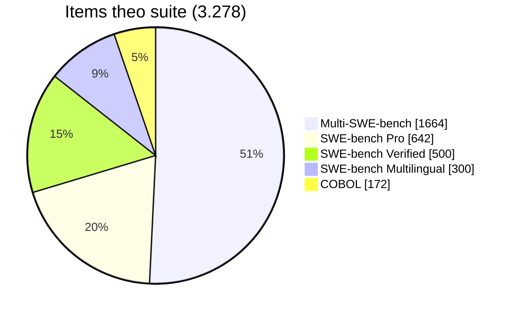
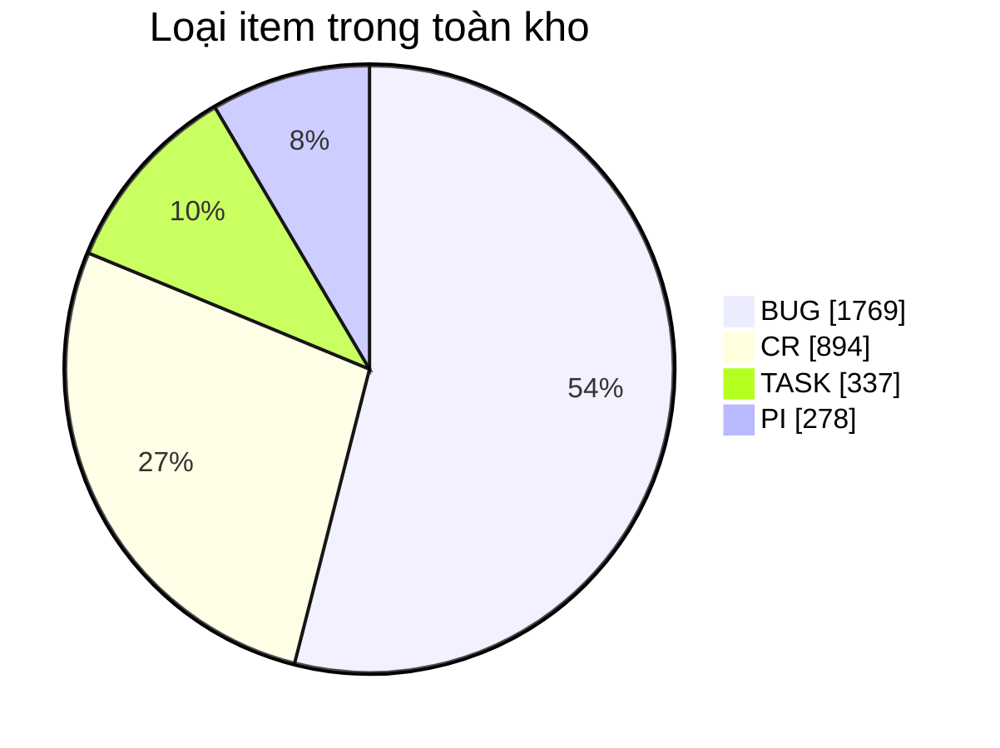
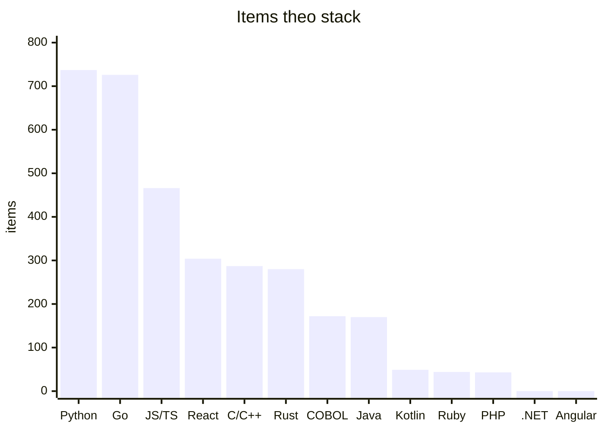
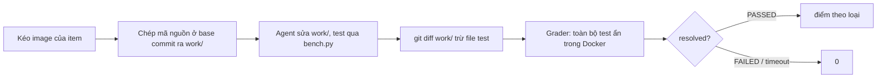
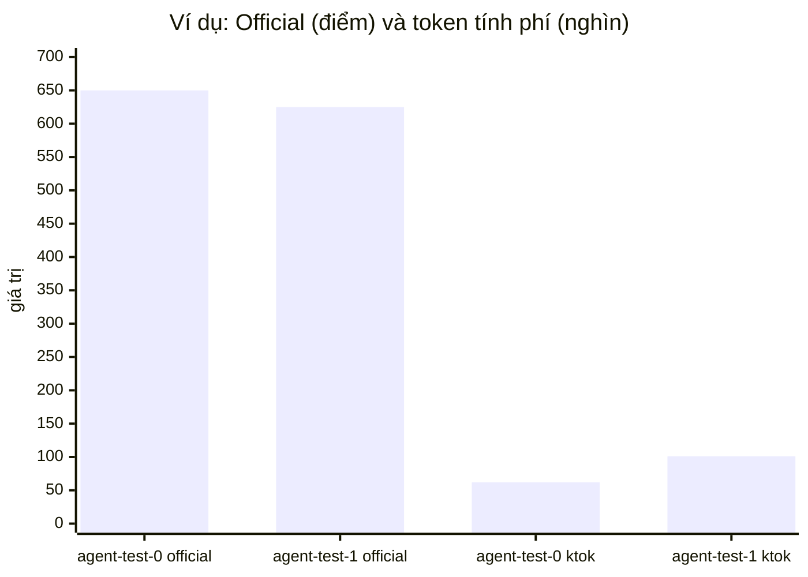

# Đặc tả bộ benchmark `arena`

Bộ benchmark để chọn model/effort và prompt cho Digital Project Team trước trận Master the Machine.
Mỗi item là **một** backlog item (một issue có bản sửa và test ẩn), gán một trong bốn loại của cuộc
thi (TASK, CR, BUG, PI), chấm bằng test ẩn của benchmark gốc trong Docker. Số liệu dưới đây lấy từ
`python -m arena stats` và `data/sets/*.json`, cập nhật 2026-10-22.

## 1. Tổng hợp từ những benchmark nào

| Suite | Nguồn | Ngôn ngữ | Items | Cách chấm | Bước `check` của agent |
|---|---|---|---|---|---|
| `swe-verified` | SWE-bench Verified (HF `SWE-bench/SWE-bench_Verified`) | Python | 500 | eval script + log parser của `swebench` | chỉ chạy các file test mà test patch đụng tới |
| `swe-multilingual` | SWE-bench Multilingual | Ruby, Java, Rust, PHP, Go, C, JS, TS, C++ | 300 | như trên | như trên |
| `swe-pro` | SWE-bench Pro public V2 (`scaleapi/SWE-bench_Pro-os`) | Go, Python, JS, TS | 642 | `tests/test.sh` kiểu Harbor → reward | test của task (thường nhanh) |
| `multi-swe` | Multi-SWE-bench (`ByteDance-Seed/Multi-SWE-bench`) | Go, JS, Rust, TS, Java, C, C++, Kotlin | 1.664 | `fix-run.sh` + parser của `multi_swe_bench` | **cả bộ test của repo** (chậm với Java/TS lớn) |
| `cobol` | tự xây: COBOLEval + chương trình batch legacy (CardDemo, khoá học) | COBOL | 172 | `tests/test.sh` trên GnuCOBOL | test của task (vài giây) |
| **Tổng** | | 12 ngôn ngữ, 99 repo | **3.278** | | |

Một issue chỉ tính một lần: phần Python của Multi-SWE-bench trùng SWE-bench Verified và một phần
trùng Multilingual nên bị bỏ; 56 issue Kotlin không có harness bị bỏ.

## 2. Các set benchmark và khác biệt cơ bản

Bốn set **lồng nhau** (`xs ⊂ s ⊂ m ⊂ full`), sinh bằng `sample --size <size>` với seed cố định.
Mỗi set giữ một hạn ngạch cho **5 stack FPT** (Java, .NET, React, Angular, COBOL: các stack công ty
dùng nhiều nhất, nên nhiều khả năng là sản phẩm của đề thi) cộng một hạn ngạch cho các stack khác (đề
thi không báo trước stack). Trong mỗi hạn ngạch, loại item xoay vòng BUG → CR → PI → TASK.

| Set | Mỗi stack FPT | Stack khác | Items hiện có* | Deadline | Điểm tối đa | Timeout/item | Trả lời câu hỏi |
|---|---|---|---|---|---|---|---|
| `xs` | 1 (không Java: build chậm) | 0 | 2 | 1 | 450 | 15 phút | pipeline/prompt có hỏng không? |
| `s` | 1 | 5 | 8 | 4 | 1.750 | 15 phút | đổi prompt/model có tệ đi rõ không? |
| `m` | 2 | 10 | 16 | 8 | 3.700 | 30 phút | điền `p`, `t` theo loại vào `routing.json` |
| `full` | 4 | 20 | 32 | 13 | 7.250 | 30 phút | chốt model/effort trước trận thật |

\* Catalog hiện **chưa có .NET và Angular** nên hai ô đó để trống (đủ sẽ là 4 / 10 / 20 / 40 item).
`sample` báo rõ stack còn thiếu.

Thành phần hiện tại:

| Set | Loại item | Stack |
|---|---|---|
| `xs` | PI 1, BUG 1 | React (element-web), COBOL (CardDemo) |
| `s` | BUG 4, PI 2, CR 1, TASK 1 | React, COBOL, Java (druid), C (micropython), Go (navidrome), JS (immutable-js), Python (ansible), Ruby (jekyll) |
| `m` | BUG 5, CR 5, PI 3, TASK 3 | React 2, COBOL 2, Java 2, C/C++ 2, Go 2, JS/TS 2, Ruby 2, Python 1, Rust 1 |
| `full` | BUG 9, CR 8, PI 8, TASK 7 | React 4, COBOL 4, Java 4, Ruby 4, C/C++ 3, Go 3, JS/TS 3, Python 3, Rust 2, PHP 2 |

Kotlin không xuất hiện: ảnh Docker của Multi-SWE-bench Kotlin (`mswebench/pinterest_m_ktlint`, `ankidroid`)
không có trên Docker Hub, nên stack này bị loại khỏi mọi set (`core.UNAVAILABLE_STACKS`).

```mermaid
xychart-beta
    title "Số item mỗi set (hiện có / khi đủ .NET và Angular)"
    x-axis ["xs", "s", "m", "full"]
    y-axis "items" 0 --> 45
    bar [2, 8, 16, 32]
    bar [4, 10, 20, 40]
```

Luật chọn item trong mỗi ô (áp dụng theo thứ tự):

1. Loại item hỏng hạ tầng (gold patch không pass khi `check`, ví dụ `php-cs-fixer-7998`), item trong danh
   sách loại trừ (`cli.EXCLUDED_ITEMS`, ví dụ `logstash-15928`: một lần check hơn 12 phút) và stack không
   có ảnh Docker (`core.UNAVAILABLE_STACKS`: Kotlin).
2. Suite có bước check **tập trung** trước Multi-SWE-bench (check chạy cả suite).
3. Repo là **sản phẩm** (element-web, protonmail, druid, logstash, CardDemo, navidrome…) trước thư viện,
   vì đề thi là bảo trì một sản phẩm đang chạy.
4. Item đã có agent chạy, rồi item đã qua `check`, để kết quả cũ được tái dùng khi đổi luật.
5. Còn lại ngẫu nhiên theo seed, riêng cho từng (size, stack).

**Deadline**: cứ hai item cùng loại BUG/CR/TASK thì một item có deadline (12/15/10 phút tính từ lúc
agent bắt đầu), PI không bao giờ có. Deadline lưu trong file set, cùng item ở mọi size.

## 3. Thống kê theo suite và theo stack

### 3.1. Theo suite × loại item

| Suite | Items | Repos | BUG | CR | TASK | PI | Ngôn ngữ |
|---|---|---|---|---|---|---|---|
| SWE-bench Verified | 500 | 12 | 330 | 76 | 11 | 83 | Python 500 |
| SWE-bench Multilingual | 300 | 41 | 198 | 60 | 5 | 37 | Ruby 44, Java 43, Rust 43, PHP 43, Go 42, C 30, JS 26, TS 17, C++ 12 |
| SWE-bench Pro | 642 | 11 | 223 | 253 | 143 | 23 | Go 256, Python 237, JS 145, TS 4 |
| Multi-SWE-bench | 1.664 | 41 | 1.006 | 500 | 32 | 126 | Go 428, JS 355, Rust 237, TS 223, Java 127, C 124, C++ 121, Kotlin 49 |
| COBOL | 172 | 3 | 12 | 5 | 146 | 9 | COBOL 172 |
| **Tổng** | **3.278** | 99 | **1.769** | **894** | **337** | **278** | |

### 3.2. Theo tech stack

Stack suy từ repo (React, Angular) hoặc ngôn ngữ (còn lại); "Apps" là số repo dạng sản phẩm.

| Stack | Items | Repos | Apps | BUG | CR | TASK | PI | Ghi chú |
|---|---|---|---|---|---|---|---|---|
| Java (FPT) | 170 | 14 | 2 | 105 | 42 | 0 | 23 | druid, logstash là app; còn lại thư viện (jackson, gson, lombok…) |
| .NET (FPT) | **0** | 0 | 0 | 0 | 0 | 0 | 0 | **thiếu**; nguồn khả thi: `microsoft/SWE-Sharp-Bench` (150 item C#, chưa có image) |
| React (FPT) | 304 | 6 | 3 | 154 | 98 | 42 | 10 | element-web, protonmail webclients, insomnia là app; material-ui, preact, docusaurus |
| Angular (FPT) | **0** | 0 | 0 | 0 | 0 | 0 | 0 | **thiếu**; chưa có benchmark công khai, dự kiến tự xây suite Spring Boot + Angular |
| COBOL (FPT) | 172 | 3 | 2 | 12 | 5 | 146 | 9 | CardDemo + khoá học (BUG/CR/PI), COBOLEval (TASK) |
| Python | 737 | 15 | 3 | 407 | 163 | 67 | 100 | |
| Go | 726 | 12 | 5 | 312 | 345 | 48 | 21 | |
| JS/TS khác | 466 | 12 | 1 | 342 | 74 | 24 | 26 | svelte, vue, babel, dayjs… |
| C/C++ | 287 | 11 | 0 | 182 | 52 | 4 | 49 | |
| Rust | 280 | 14 | 0 | 168 | 83 | 3 | 26 | |
| Kotlin | 49 | 2 | 0 | 33 | 10 | 1 | 5 | **không chạy được**: ảnh Docker không có trên Hub, loại khỏi set |
| Ruby | 44 | 6 | 0 | 29 | 8 | 2 | 5 | |
| PHP | 43 | 4 | 0 | 25 | 14 | 0 | 4 | |

### 3.3. Loại item được gán thế nào

Các benchmark gốc không có khái niệm TASK/CR/BUG/PI; `arena` gán bằng luật từ khoá
(`core.classify`): tiêu đề/mô tả có crash, traceback, exception, regression… → **PI**; add, support,
allow, implement… → **CR**; refactor, docs, rename, upgrade… → **TASK**; còn lại → **BUG**.
SWE-bench Pro có nhãn riêng (`*_bug`, `*_feat`, `*_enh`) được dùng thay. Suite COBOL gán tay. Vì vậy nhãn
loại là gần đúng; trong trận thật item có sẵn type (Q&A #21).

**MVS** cũng do `arena` tạo: 2 test đầu trong FAIL_TO_PASS (chỉ CR/BUG) được đưa cho agent, grader vẫn
chấm bằng **toàn bộ** FAIL_TO_PASS + PASS_TO_PASS, đúng tinh thần "Grader chấm thêm kịch bản khác".
PI chỉ nhận đoạn đầu của mô tả (tối đa 400 ký tự) và không có MVS.

## 4. Cách đánh giá item và điểm cuối cùng

### 4.1. Một item

Mỗi item ghi: `resolved`, `agent_seconds` (tới lúc agent dừng, gồm cả thời gian chờ test),
`grade_seconds`, `usage` (token), số lệnh, số file sửa, phút tới lần sửa đầu, MVS xanh hay không.

### 4.2. Điểm theo luật thi (`metrics.match_table`)

| Thành phần | Luật | Trong benchmark |
|---|---|---|
| Điểm item | PASSED = điểm loại; FAILED hoặc chưa xong = 0 | PI 250, CR 300, BUG 200, TASK 150 (bố cục trận mẫu); `/1000` = chuẩn hoá theo điểm tối đa của set |
| Deadline | nộp sau deadline bị từ chối | `agent_seconds` > deadline của item → 0, đếm vào cột Late |
| PI | nhanh nhất 100%, nhì 90%, ba 75%, còn lại 60%, tính từ lúc đề hiện tới lúc chấm PASSED | xếp hạng **giữa các agent trong report** (đóng vai các đội), thời gian = agent + chấm |
| Official | tổng điểm item − 50 mỗi lần vào máy | tổng điểm item (không có vào máy) |
| Tie-breaker | mỗi 1% nhanh hơn trung bình (mốc item cuối) +10; mỗi 1% ít credit hơn trung bình +10 | tính giữa các agent đã chạy **cùng** bộ item; để trống khi chưa so được |

Ngoài ra `report` còn có: tỉ lệ pass theo suite và theo loại, phút trung vị/P90, token tính phí
(input không cache + output), điểm mỗi phút, điểm mỗi triệu token, tỉ lệ "MVS xanh nhưng fail", và
bảng **routing**: với mỗi loại item, agent cho nhiều điểm kỳ vọng mỗi phút nhất ("Best") và agent rẻ
nhất trong số có tỉ lệ pass cách Best ≤ 10 điểm ("Frugal"). Routing cần ≥ 2 item mỗi loại.

### 4.3. Ví dụ: so sánh hai agent (và các kết quả đã có)

Kết quả đã đo (chi tiết trong `REPORT_harness_xs.md`, `REPORT_lean_s.md`, `OPTIMIZATION.md`):

| Set | Agent | PASSED | Token tính phí | Mốc cuối | Ghi chú |
|---|---|---|---|---|---|
| xs | agent-test-0 (Codex low) | 2/2 | 43k | 2,3' | baseline |
| xs | agent-test-1 (Codex high) | 2/2 | 65k | 2,8' | effort cao không giải thêm bài |
| xs | codex-ruflo-low | 2/2 | 78k | 2,4' | không gọi tool ruflo nào |
| xs | opencode-low | 2/2 | 90k | 2,6' | |
| xs | hermes-low | 2/2 | 73k | 2,8' | |
| s | agent-test-0 | 8/8 | 195k | 3,9' | baseline |
| s | codex-lean-low | 8/8 | 135k | 3,8' | luật đọc lát + cap output |
| s | codex-lean2-low | 8/8 | **131k** | **3,7'** | lean + đề nhúng; cấu hình của worker thi đấu |

Ví dụ dưới đây là lần chạy 3 item ngày 2026-10-21 (set xs lúc đó còn item Java).

Hai agent cùng model `gpt-6.1-sol`, khác effort, chạy 3 item ngày 2026-10-21 (druid Java BUG có deadline
12 phút, element-web React PI, CardDemo COBOL BUG):

| Item | Loại | Điểm tối đa | agent-test-0 (effort low) | agent-test-1 (effort high) |
|---|---|---|---|---|
| apache/druid-16875 | BUG, deadline 12' | 200 | PASSED · 2,9' · 19k tok → **200** | PASSED · 4,0' · 36k tok → **200** |
| element-web (PI) | PI | 250 | PASSED · 1,9' + chấm 0,4' → nhanh nhất ×1,0 → **250** | PASSED · 2,4' + chấm 0,4' → nhì ×0,9 → **225** |
| cobol-carddemo-16 | BUG | 200 | PASSED · 0,6' · 20k tok → **200** | PASSED · 0,9' · 23k tok → **200** |
| **Official** | | 650 | **650** (1000/1000) | **625** (962/1000) |
| Mốc hoàn thành cuối | | | 3,9 phút | 5,0 phút |
| Token tính phí | | | 62k | 101k |
| TB time / TB credit | | | +125 / +236 | −125 / −236 |

Đọc kết quả: cả hai giải đúng 3/3, nên khác biệt chỉ nằm ở tốc độ (PI về nhì mất 25 điểm) và token
(+63% với effort high). Nếu Official bằng nhau, tie-breaker +361 so với −361 sẽ quyết định. Routing
từ mẫu này (mới đủ dữ liệu cho BUG): Best = Frugal = agent-test-0. Mẫu 3 item quá nhỏ để kết luận; đó là
việc của set `m`/`full`.

## 5. Giới hạn hiện tại

- Không có .NET và Angular trong kho (xem §3.2).
- Nhãn loại item và MVS là do `arena` tạo (§3.3); PI xếp hạng giữa các agent chứ không có "đội khác".
- Item chạy **tuần tự, từng cái một** với timeout riêng; chưa mô phỏng đồng hồ 40 phút chung, wave,
  pause, hay phạt vào máy −50 (phần đó thuộc mock Game Master trong `mock_gm/`).
- Với Multi-SWE-bench, bước check chạy cả suite nên số phút của Java/TS lớn bị phóng đại; set nhỏ tránh
  suite này.
- `agent_seconds` gồm cả thời gian chờ build/test: với Java, phần máy biên dịch có thể lớn hơn phần AI.
