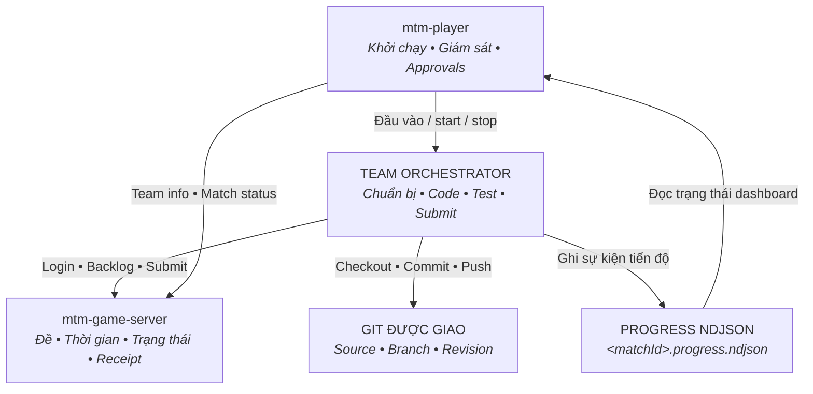
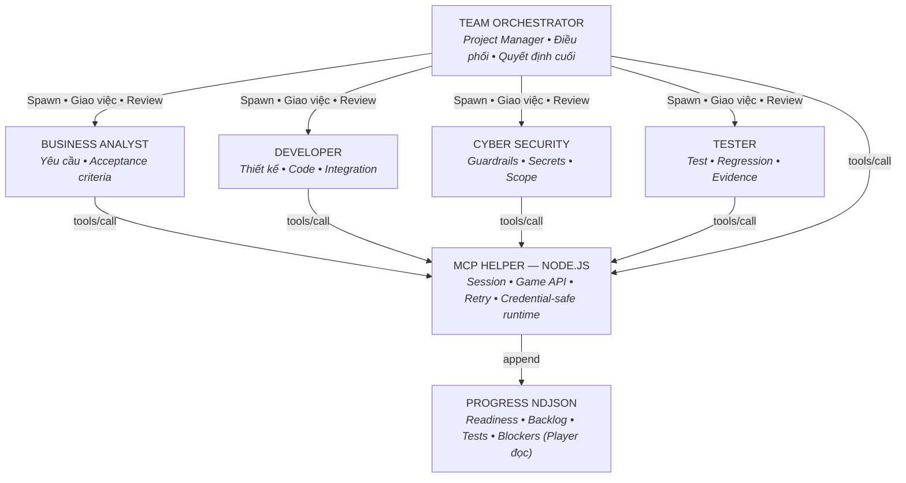

**MASTER THE MACHINE · CONTESTANT GUIDE**
# Xây Team Orchestrator cho MTM
*Phiên bản tài liệu: 0.5.1*
> **Ghi chú môi trường / Note:** Note: Hệ thống hiện tại của Ban Tổ Chức có thể hỗ trợ cả Codex và Claude Code. Tuy nhiên, để tạo ra môi trường đồng nhất và công bằng cho Orchestrator của các đội thi đấu với nhau, Ban Tổ Chức quyết định sử dụng Codex làm môi trường thi đấu. Vì vậy, xin đừng hỏi có thể dùng Claude Code để thi đấu hay không.
## Mục lục / Table of Contents

---

## 1. Mô hình cuộc chơi {#section-1}



| Thành phần | Vai trò | Đầu vào / đầu ra chính |
| --- | --- | --- |
| mtm-game-server | Cung cấp match/backlog/assignment, quản lý thời gian và trạng thái, nhận submissions và trả receipt. Grading/điểm là kết quả chính thức từ hệ thống tổ chức. | Account/cookie cho projection; team bearer cho Start/Submit. Trả match/team/repo/backlog/API endpoints và receipt. |
| mtm-player | mtm-player init, kiểm tra pack, chạy CLI/Team Orchestrator Agent, gửi access cho từng phase, nhận readiness, theo dõi match, stop/resume, approvals và dashboard. | Input operator: workspace, team, match, server access, model/approval choices. Output cho Team Orchestrator Agent: dữ liệu chuẩn bị/game/control/recovery. |
| Team Orchestrator | Hệ thống của đội: chuẩn bị source, đồng bộ đề, quyết định thứ tự, code/test, commit/push, gọi Start Work/Submit và báo progress. | Nhận dữ liệu từ mtm-player, public đề từ Server; trả readiness và append log. Có thể dùng worker nội bộ. |
| Git được giao | Source/branch/folder của đề và immutable revision để submit. | Team Orchestrator Agent checkout, commit, push trong phạm vi được giao. |
| Progress NDJSON | Kênh trạng thái nghiệp vụ để mtm-player dựng preparation/backlog/tests/blockers/API activity. | Team helper/Team Orchestrator Agent append; mtm-player đọc. Transcript không thay thế log. |

> mtm-game-server quyết định trạng thái trận và acceptance. Progress log báo trạng thái của đội và transcript không thay thế các log bắt buộc.

## 2. Cấu trúc orchestrator gợi ý {#section-2}

Sơ đồ dưới đây đề xuất Team Orchestrator làm Project Manager cùng bốn agent theo vai trò. Thư mục agents trong pack example dùng cùng cấu trúc: mỗi file TOML có name khớp tên agent và description. Đây là cấu trúc tham khảo; registrations được mtm-player chấp nhận có thể phụ thuộc phiên bản. MCP Helper và Progress NDJSON là thành phần runtime dùng chung.



> ⚠️ **CẢNH BÁO / CHÚ Ý:** MUST NOT — Team Orchestrator chỉ được spawn subagent bằng cơ chế native của provider trong cùng CLI session đang chạy. Không khởi chạy thêm Codex CLI, Claude Code CLI, app-server hoặc CLI process độc lập khác để thực hiện công việc của trận.

| Module | Nhiệm vụ |
| --- | --- |
| Team Orchestrator Agent | Đóng vai trò Project Manager: nhận lifecycle input, chọn backlog, giao việc, kiểm tra kết quả, tích hợp thay đổi và chịu trách nhiệm quyết định cuối. |
| Business Analyst | Đọc backlog, làm rõ yêu cầu, acceptance criteria, constraint và dữ liệu đầu vào cho Developer và Tester. |
| Developer | Khảo sát source, thiết kế thay đổi, implement, chạy kiểm tra kỹ thuật và chuẩn bị commit. |
| Cyber Security | Kiểm tra guardrail, phạm vi workspace/network, credential handling và các hành động có nguy cơ violation. |
| Tester | Lập test scenario từ acceptance criteria, chạy regression, xác nhận kết quả và evidence trước submission. |
| MCP Helper — Node.js | Runtime dùng chung cho session, cookie/bearer trong memory, Game API, retry/idempotency và append progress log. Các agent gọi helper thay vì tự giữ credential hoặc tự gọi HTTP. |
| Progress NDJSON | File trạng thái bắt buộc để mtm-player đọc readiness, backlog, test, blocker và API activity. MCP Helper append từng JSON object trên một dòng vào đúng progressLogFile; transcript không thay thế file này. |

### Cấu trúc khai báo agent

Ví dụ cấu trúc dưới đây tương ứng với role Developer trong sơ đồ, sử dụng file `agents/team_developer.toml`.

<details>
<summary><b>agents/team_developer.toml — cấu trúc minh họa</b></summary>

Sao chép

```toml
name = "team_developer"
description = "Developer agent profile."
```

</details>

Tên trong trường `name` phải trùng với tên agent trong tên file (bỏ phần mở rộng `.toml`). Các file profile chỉ minh họa cấu trúc khai báo; chúng không chứa instruction hoặc source triển khai.

<details>
<summary><b>Cấu trúc folder source package và workspace sau khi cài</b></summary>

Sao chép

```text
team-orchestrator-pack-example/
  package.json
  team-pack-info.json
  team-runtime.json
  logs/MATCH_ID.progress.ndjson # file trống; thay MATCH_ID bằng matchId thực
  README.md
  install.ps1
  agents/                      # root + four roles from section 2
    team-orchestrator.toml
    team-business-analyst.toml
    team-developer.toml
    team-cyber-security.toml`n    team-tester.toml
  config/codex.toml
  skills/                      # instruction structure
    team-orchestrator/SKILL.md
    game-preparation/SKILL.md
    team-recovery/SKILL.md
  bin/runtime-server.mjs       # MCP Helper
  src/runtime-session.mjs
  contracts/progress-event.schema.json
  docs/README.md
  scripts/install.mjs
  scripts/check-distribution.mjs

The five agent files show the suggested structure in section 2. Each file contains only a matching name and description. This is an illustrative role structure; mtm-player registration compatibility depends on the installed mtm-player version. MCP Helper and Progress NDJSON are shared runtime components, not agent profiles.

Sau cài đặt: <teamWorkspace>/
  matches/
    <matchId>/             # checkoutRoot: Git checkout, chứa .git/
      <repository.folder>/ # matchRoot: folder bài thi được giao
        src/
        challenge/
        answers/
          <backlogId>/
            submit.json
            evidence/
  team-sdlc-pack/runtime/     # payload bất biến
  team-sdlc-pack/logs/        # log riêng từng round/session
  .mtm/                      # team-runtime.json, team-pack-info.json
  .codex/agents/             # bản sao các profile
  .codex/config.toml         # MCP path tuyệt đối
  .agents/skills/            # bản sao các skill
```

#### team-pack-info.json — file bắt buộc có cấu trúc cố định

MUST tạo file này tại thư mục gốc package. Giữ đúng 4 field như mẫu; không đổi tên field và không thêm field. schemaVersion giữ số 1. Thay teamId và teamName bằng mã và tên đội đã đăng ký trên mtm-game-server; teamId không phải UUID. Thay version bằng phiên bản package, MUST giống version trong package.json và team-runtime.json.

Sao chép

```json
{
  "schemaVersion": 1,
  "version": "1.0.0",
  "teamId": "HNKSUPER",
  "teamName": "HNK Super"
}
```

Ví dụ trên là identity của HNKSUPER. Đội khác MUST thay identity của mình trước khi build. Installer copy file vào team-sdlc-pack/runtime/team-pack-info.json và .mtm/team-pack-info.json trong TeamWorkspace. mtm-player đọc identity này khi Load team pack; hai bản MUST đồng bộ. Xem [phần 5](#section-5) để biết giới hạn ký tự và quy tắc đặt tên.

</details>

### Checkout root và match root

Dùng đường dẫn tuyệt đối do mtm-player cung cấp. `checkoutRoot` chứa Git checkout và `.git/`. `matchRoot = checkoutRoot/repository.folder` chứa source được giao, đề bài công khai, answers và evidence. Match ID lặp lại trong ví dụ là có chủ ý: folder ngoài xác định checkout trên máy, folder trong đến từ repository assignment của server.

Clone vào `checkoutRoot`; build, test và ghi answers trong `matchRoot`. Worktree của specialist dùng `worktreeRoot/repository.folder` làm matchRoot. Truyền cả hai đường dẫn cho specialist. Field tương thích `challengeWorkspace` có thể trỏ tới `matches/`; dùng hai root tường minh, không coi field này là folder source. Không sửa folder của các match khác. Init/reset chỉ tác động checkout của match được chọn; các match cũ vẫn được giữ lại. Resume dùng đường dẫn đã lưu và giữ công việc đã hoàn thành.

### Tool helper cần triển khai

| Tool gợi ý | Input | Output và hành vi |
| --- | --- | --- |
| configure_session | descriptor, modelPolicy nếu có | Safe session/paths; prepare derives paths từ trusted cwd; start giữ verified portal/repo và thay bearer client; resume thay access từ dữ liệu mới. |
| login_match | {} | Authenticate cookie session; chỉ trả status an toàn. |
| refresh_match | {} | Projection hiện tại; identity/repo verification; DISCOVERED mới chỉ trong game. |
| start_work | backlogItemKey | Public requirements/template/scenarios; tự log trước/sau HTTP. |
| submit_work | clientSubmissionId, backlogItemKey, gitRevision, answer | Official receipt; UUID giữ nguyên khi response không rõ. |
| report_progress | event chưa có envelope | Bổ sung schemaVersion/playerSessionId và append schema-valid event. |
| wait_for_update | timeoutMs ≤ 55000 | Serial bounded polling; return khi đổi hoặc timeout; dừng theo control. |

MCP qua stdin/stdout: JSON-RPC mỗi dòng; triển khai initialize, notifications/initialized, tools/list và tools/call. tools/list phải có inputSchema cho từng tool. Chỉ JSON-RPC lên stdout; tool output dạng content text chứa JSON an toàn. Request có timeout, response size limit và redirect/origin checks.

## 3. Từ lúc spawn đến finish game {#section-3}

> MUST log GAME_MASTER_API REQUESTED ngay trước *mọi* request login/refresh/Start/Submit; SUCCEEDED hoặc FAILED ngay sau kết quả, kể cả lỗi. Sequence dùng tên thao tác và dữ liệu; các bước dưới giải thích đầy đủ input/output.

```mermaid
sequenceDiagram
    autonumber
    actor Player as mtm-player
    participant Orch as Orchestrator
    participant Server as mtm-game-server
    participant Git as Assigned Git
    participant Log as Progress log (<matchId>.progress.ndjson)

    Player->>Orch: 1. Spawn Team Orchestrator Agent mới (team, match, repo, origins, models)
    Orch->>Log: 2. MUST: ORCHESTRATOR_STARTED (schemaVersion=1, playerSessionId, type)
    Orch->>Git: 3. Kiểm tra quyền Git -> checkout đúng source
    Orch->>Log: 4. Cài dependencies -> build -> baseline checks (PREPARATION_STATUS)
    Orch->>Server: 5. Đăng nhập tại URL mtm-game-server do mtm-player cung cấp
    Orch->>Server: 6. Truy cập /match/<matchId> kiểm tra đề, đội, repo
    Orch->>Log: 7. MUST: MATCH_LOGIN completed + ENVIRONMENT_READY
    Orch->>Player: 8. Trả kết quả môi trường đã sẵn sàng (status=ENVIRONMENT_READY)
    Player->>Server: 9. Gửi Preparation Complete (PREPARED -> chờ IN_PROGRESS)
    Player->>Orch: 10. Cho phép bắt đầu làm backlog (bearer key, API scopes, paths)
    Orch->>Server: 11. Đọc trang /match/<matchId> sau đăng nhập (backlog, hướng dẫn)
    Orch->>Log: 12. MUST: BACKLOG_SYNC completed; DISCOVERED từng item
    Orch->>Server: 13. POST /api/v1/matches/<UUID>/backlogs/start {backlogItemKey: "TASK-01"}
    Server-->>Orch: Template nguồn/scenarios (tạo answers/<ID>/submit.json & evidence/)
    Orch->>Log: 14. MUST: BACKLOG_STATUS IN_PROGRESS; BACKLOG_TESTS NOT_RUN
    Orch->>Orch: 15. Implement -> chạy test -> hoàn thành answer (test RUNNING -> PASSED/FAILED)
    Orch->>Git: 16. Commit và push lên đúng branch (full pushed Git SHA)
    Orch->>Server: 17. POST /api/v1/matches/<UUID>/submissions {clientSubmissionId, backlogItemKey, gitRevision, answer}
    Server-->>Orch: 18. Server trả receipt hoặc lỗi (receiptId, status=RECEIVED)
    Orch->>Log: 19. MUST: BACKLOG_STATUS SUBMITTED (revision + official receiptId)
    Player->>Orch: 20. Báo pause hoặc trận đã kết thúc (PAUSED / FINISHED / CANCELLED)
    Orch->>Log: 21. Dừng API, Git, workers; log ORCHESTRATOR_ENDED (hoặc chờ resume)
    Note over Player,Orch: 22. Nếu được resume: mtm-player spawn Orchestrator thay thế
    Orch->>Log: 23. MUST: ORCHESTRATOR_RESTARTED (đối soát log/Git/receipt; không lặp submission đã nhận)
```

**MUST:** ghi log vào `<TeamWorkspace>/team-sdlc-pack/logs/<matchId>.progress.ndjson`. Với match ví dụ: `ABCD1234.progress.ndjson`. Khi mtm-player cung cấp `progressLogFile`, MUST dùng đúng đường dẫn đó; mỗi event là một JSON trên một dòng, append và không ghi đè.

### Hướng dẫn thực hiện từng bước

`[Team Orchestrator Agent: nhận đầu vào]` `[mtm-player: cung cấp đầu vào]` 

### 1. Nhận thông tin và khởi tạo

Team Orchestrator Agent nhận session/team/match, repository, quyền đọc Git, account/password, allowed origins và model policy. Đọc workspace AGENTS.md. Team Orchestrator Agent không có bearer key trong bước này.

<details>
<summary><b>Input đầy đủ — chuẩn bị</b></summary>

Sao chép

```json
{
  "schemaVersion": 1,
  "playerSessionId": "session-example",
  "teamId": "T01",
  "teamName": "Đội ví dụ",
  "matchId": "ABCD1234",
  "type": "PREPARE_GAME",
  "requestId": "prepare-example",
  "username": "example-account",
  "password": "FAKE_PASSWORD_FOR_EXAMPLE",
  "matchPageUrl": "https://ai-fest-five.vercel.app/match",
  "allowedMatchOrigins": [
    "https://ai-fest-five.vercel.app"
  ],
  "repository": {
    "url": "https://github.com/example/repo.git",
    "branch": "main",
    "folder": "ABCD1234"
  },
  "hostAuthorization": {
    "schemaVersion": 1,
    "type": "MTM_PREPARATION_HOST_AUTHORIZATION",
    "authority": "ORGANIZER_DECLARED_SCOPE",
    "playerSessionId": "session-example",
    "matchId": "ABCD1234",
    "inheritance": "ORCHESTRATOR_TREE",
    "enforcement": "TEAM_RESPONSIBILITY",
    "taskPermissions": "INHERIT",
    "credentialUse": "HOST_GIT_CREDENTIAL_TO_ASSIGNED_REPOSITORY_ONLY",
    "repository": {
      "url": "https://github.com/example/repo.git",
      "branch": "main",
      "folder": "ABCD1234"
    },
    "gitOperations": [
      "READ_ASSIGNED_REPOSITORY",
      "CLONE_ASSIGNED_BRANCH",
      "FETCH_ASSIGNED_BRANCH"
    ]
  },
  "checkoutRoot": "D:/mtm/T01/matches/ABCD1234",
  "matchRoot": "D:/mtm/T01/matches/ABCD1234/ABCD1234"
}
```

</details>

<details>
<summary><b>Log đầu tiên — MUST</b></summary>

**MUST ghi vào file:** `<TeamWorkspace>/team-sdlc-pack/logs/<matchId>.progress.ndjson`Ví dụ: `D:/mtm/T01/team-sdlc-pack/logs/ABCD1234.progress.ndjson`.Dùng đúng `progressLogFile` của phiên hiện tại khi được cung cấp. **Nội dung append:** JSON bên dưới + một newline (UTF-8). Không ghi đè file. Thay playerSessionId và các giá trị mẫu bằng dữ liệu thực.Sao chép

```ndjson
{"schemaVersion":1,"playerSessionId":"session-example","type":"ORCHESTRATOR_STARTED","summary":"Orchestrator bắt đầu."}
```

</details>

`[Team Orchestrator Agent: checkout source]` 

### 2. Source Check Out

Team Orchestrator Agent kiểm tra quyền Git do host cung cấp, rồi checkout đúng repository, branch và folder được giao vào challenge. MUST append PREPARATION_STATUS stage GIT_AUTH và REPOSITORY khi từng kiểm tra bắt đầu/kết thúc; chỉ báo COMPLETED sau khi xác minh source và revision. Không push trong preparation.

**MUST ghi vào file:** `<TeamWorkspace>/team-sdlc-pack/logs/<matchId>.progress.ndjson`Ví dụ: `D:/mtm/T01/team-sdlc-pack/logs/ABCD1234.progress.ndjson`.Dùng đúng `progressLogFile` của phiên hiện tại khi được cung cấp. **Nội dung append:** JSON bên dưới + một newline (UTF-8). Không ghi đè file. Thay playerSessionId và các giá trị mẫu bằng dữ liệu thực.Sao chép

```ndjson
{"schemaVersion":1,"playerSessionId":"session-example","type":"PREPARATION_STATUS","stage":"GIT_AUTH","status":"COMPLETED","summary":"Quyền Git với repository được giao đã xác minh."}
```

**MUST ghi vào file:** `<TeamWorkspace>/team-sdlc-pack/logs/<matchId>.progress.ndjson`Ví dụ: `D:/mtm/T01/team-sdlc-pack/logs/ABCD1234.progress.ndjson`.Dùng đúng `progressLogFile` của phiên hiện tại khi được cung cấp. **Nội dung append:** JSON bên dưới + một newline (UTF-8). Không ghi đè file. Thay playerSessionId và các giá trị mẫu bằng dữ liệu thực.Sao chép

```ndjson
{"schemaVersion":1,"playerSessionId":"session-example","type":"PREPARATION_STATUS","stage":"REPOSITORY","status":"COMPLETED","summary":"Đã checkout đúng repository, branch, folder và revision."}
```

`[Team Orchestrator Agent: setup environment và build]` 

### 3. Environment Setup

Team Orchestrator Agent kiểm tra Git, Node.js/npm hoặc toolchain mà source thực sự yêu cầu; cài dependencies khóa phiên bản, chạy baseline tests và build. MUST append PREPARATION_STATUS stage ENVIRONMENT và BUILD khi bắt đầu/kết thúc. Chỉ báo COMPLETED khi từng kiểm tra thật sự đạt; lỗi phải báo FAILED/BLOCKED và không gửi ENVIRONMENT_READY.

**MUST ghi vào file:** `<TeamWorkspace>/team-sdlc-pack/logs/<matchId>.progress.ndjson`Ví dụ: `D:/mtm/T01/team-sdlc-pack/logs/ABCD1234.progress.ndjson`.Dùng đúng `progressLogFile` của phiên hiện tại khi được cung cấp. **Nội dung append:** JSON bên dưới + một newline (UTF-8). Không ghi đè file. Thay playerSessionId và các giá trị mẫu bằng dữ liệu thực.Sao chép

```ndjson
{"schemaVersion":1,"playerSessionId":"session-example","type":"PREPARATION_STATUS","stage":"ENVIRONMENT","status":"COMPLETED","summary":"Toolchain và dependencies cần thiết đã sẵn sàng."}
```

**MUST ghi vào file:** `<TeamWorkspace>/team-sdlc-pack/logs/<matchId>.progress.ndjson`Ví dụ: `D:/mtm/T01/team-sdlc-pack/logs/ABCD1234.progress.ndjson`.Dùng đúng `progressLogFile` của phiên hiện tại khi được cung cấp. **Nội dung append:** JSON bên dưới + một newline (UTF-8). Không ghi đè file. Thay playerSessionId và các giá trị mẫu bằng dữ liệu thực.Sao chép

```ndjson
{"schemaVersion":1,"playerSessionId":"session-example","type":"PREPARATION_STATUS","stage":"BUILD","status":"COMPLETED","summary":"Baseline checks và build đã đạt."}
```

`[Team Orchestrator Agent: đăng nhập]` `[mtm-game-server: xác thực]` 

### 4. Đăng nhập mtm-game-server

Mở URL mtm-game-server do mtm-player cung cấp. Đăng nhập bằng username và password trong đầu vào của mtm-player. Sau khi đăng nhập thành công, chủ động mở trang đúng matchId; không dựa vào trang redirect mặc định.

Sao chép

```text
URL ví dụ: https://ai-fest-five.vercel.app/
Username: giá trị username do mtm-player cung cấp
Password: giá trị password do mtm-player cung cấp
```

`[Team Orchestrator Agent: đọc và kiểm tra]` `[mtm-game-server: hiển thị thông tin]` 

### 5. Đọc đúng match và xác nhận assignment

Sau khi đăng nhập, truy cập URL /match/<matchId> trên cùng mtm-game-server. Ví dụ matchId ABCD1234 tương ứng https://ai-fest-five.vercel.app/match/ABCD1234. Đọc thông tin trận, đội, repository/branch/folder và backlog trên trang. Kiểm tra chúng khớp đầu vào mtm-player. Trong preparation chỉ xác nhận quyền truy cập và assignment, chưa bắt đầu làm backlog.

> MUST mở đúng trang theo matchId; /match chung không đủ để xác định đề. Output là thông tin hiển thị của trận và danh sách backlog được phép xem, không yêu cầu một response API nội bộ cụ thể.

`[Team Orchestrator Agent: ghi readiness log]` `[mtm-player: đọc và validate log]` 

### 6. Ghi log readiness

MUST ghi MATCH_LOGIN completed rồi append event ENVIRONMENT_READY vào đúng progressLogFile qua progress writer/helper của đội. mtm-player tự đọc file log khi polling, validate event và xử lý các bước cần thiết với mtm-game-server. Team Orchestrator Agent không gửi JSON này tới một API của mtm-player và không cần parent task chuyển tiếp. Final response trong CLI chỉ có thể nhắc lại kết quả để người xem đọc; riêng final response không thay thế log bắt buộc.

<details>
<summary><b>JSON append xuống progress.ndjson — MUST; đây là kênh gửi cho mtm-player</b></summary>

**MUST ghi vào file:** `<TeamWorkspace>/team-sdlc-pack/logs/<matchId>.progress.ndjson`Ví dụ: `D:/mtm/T01/team-sdlc-pack/logs/ABCD1234.progress.ndjson`.Dùng đúng `progressLogFile` của phiên hiện tại khi được cung cấp. **Nội dung append:** JSON bên dưới + một newline (UTF-8). Không ghi đè file. Thay playerSessionId và các giá trị mẫu bằng dữ liệu thực.Sao chép

```ndjson
{"schemaVersion":1,"playerSessionId":"session-example","type":"ENVIRONMENT_READY","requestId":"prepare-example","repository":{"url":"https://github.com/example/repo.git","branch":"main","folder":"ABCD1234"},"revision":"0123456789abcdef0123456789abcdef01234567","build":"PASS","matchLogin":"PASS"}
```

</details>

<details>
<summary><b>Thông tin mtm-player đọc và validate từ log</b></summary>

Sao chép

```json
{
  "schemaVersion": 1,
  "status": "ENVIRONMENT_READY",
  "requestId": "prepare-example",
  "repository": {
    "url": "https://github.com/example/repo.git",
    "branch": "main",
    "folder": "ABCD1234"
  },
  "revision": "0123456789abcdef0123456789abcdef01234567",
  "build": "PASS",
  "matchLogin": "PASS"
}
```

</details>

<details>
<summary><b>mtm-player xử lý readiness như thế nào</b></summary>

mtm-player xác minh repository, revision, build và trạng thái đăng nhập từ progress log. Khi dữ liệu hợp lệ, mtm-player tự thông báo cho mtm-game-server rằng môi trường đã sẵn sàng, lưu kết quả và cập nhật milestone chuẩn bị. Team Orchestrator Agent chỉ cần ghi đúng log; không gọi thay thao tác thuộc mtm-player.

</details>

> Luồng: Team Orchestrator Agent → helper append ENVIRONMENT_READY → progressLogFile → mtm-player polling/validate → mtm-player xử lý readiness với mtm-game-server. Nếu chưa ghi log thành công thì mtm-player chưa nhận readiness, dù transcript đã báo chuẩn bị xong.

`[mtm-player: gửi Preparation Complete]` `[mtm-game-server: xác nhận PREPARED]` 

### 7. Chờ mtm-player chấp nhận preparation

mtm-player tự xác minh readiness, thông báo trạng thái chuẩn bị lên mtm-game-server và chờ hệ thống chấp nhận. Team Orchestrator Agent không gọi thay thao tác này và không tự ghi milestone do mtm-player quản lý. Chỉ bắt đầu làm backlog khi mtm-player gửi đầu vào game đang hoạt động.

> Không có operator command riêng để start backlog sau khi preparation đã hoàn tất.

`[mtm-player: gửi đầu vào game]` `[Team Orchestrator Agent: nhận và kiểm tra]` 

### 8. Nhận access cho active game

Kiểm tra environmentRevision, bearer UTF-8 length/SHA-256, origins, scopes, paths và hostAuthorization. Thông tin repo/account trong preparation được giữ bởi helper; start không lặp lại chúng.

<details>
<summary><b>Input đầy đủ — bắt đầu game; key mẫu là giả</b></summary>

Sao chép

```json
{
  "schemaVersion": 1,
  "playerSessionId": "session-example",
  "teamId": "T01",
  "teamName": "Đội ví dụ",
  "matchId": "ABCD1234",
  "type": "START_GAME",
  "requestId": "start-example",
  "teamUuid": "22222222-2222-4222-8222-222222222222",
  "gameMasterApiUrl": "https://ai-fest-five.vercel.app/",
  "apiKeySecret": "FAKE_TEAM_KEY_FOR_EXAMPLE",
  "apiKeyLength": 25,
  "apiKeySha256": "e7d23ff3be50646498fa0736d7d6d1483834f265b620fd566b72cb98a98294c6",
  "apiKeyScopes": [
    "backlogs:start",
    "submissions:create"
  ],
  "gameMasterUrl": "https://ai-fest-five.vercel.app/",
  "matchPageUrl": "https://ai-fest-five.vercel.app/match",
  "teamInfoRequestId": "team-info-example",
  "allowedApiOrigins": [
    "https://ai-fest-five.vercel.app"
  ],
  "teamWorkspace": "D:/mtm/T01",
  "challengeWorkspace": "D:/mtm/T01/matches",
  "teamSdlcPackWorkspace": "D:/mtm/T01/team-sdlc-pack",
  "progressLogFile": "D:/mtm/T01/team-sdlc-pack/logs/ABCD1234.progress.ndjson",
  "environmentRevision": "0123456789abcdef0123456789abcdef01234567",
  "hostAuthorization": {
    "schemaVersion": 1,
    "type": "MTM_HOST_AUTHORIZATION",
    "authority": "ORGANIZER_DECLARED_SCOPE",
    "playerSessionId": "session-example",
    "matchId": "ABCD1234",
    "inheritance": "ORCHESTRATOR_TREE",
    "enforcement": "TEAM_RESPONSIBILITY",
    "taskPermissions": "INHERIT",
    "credentialUse": "TEAM_BEARER_TO_GAME_MASTER_ONLY",
    "allowedOrigins": [
      "https://ai-fest-five.vercel.app"
    ],
    "apiScopes": [
      "backlogs:start",
      "submissions:create"
    ],
    "apiOperations": [
      {
        "operation": "START_WORK",
        "method": "POST",
        "pathTemplate": "/api/v1/matches/{matchUuid}/backlogs/start"
      },
      {
        "operation": "SUBMIT",
        "method": "POST",
        "pathTemplate": "/api/v1/matches/{matchUuid}/submissions"
      }
    ],
    "gitOperations": [
      "COMMIT_ASSIGNED_REPOSITORY",
      "PUSH_ASSIGNED_BRANCH"
    ]
  },
  "gitPolicy": {
    "commitAssignedRepository": true,
    "pushAssignedRepository": true,
    "forcePush": false,
    "mutateRemote": false,
    "authentication": "ASK_USER"
  },
  "checkoutRoot": "D:/mtm/T01/matches/ABCD1234",
  "matchRoot": "D:/mtm/T01/matches/ABCD1234/ABCD1234"
}
```

</details>

`[Team Orchestrator Agent: đồng bộ backlog và ghi log]` 

### 9. Đồng bộ và báo danh sách backlog

Đọc lại trang /match/<matchId>; ghi BACKLOG_SYNC in progress/completed. MUST ghi DISCOVERED cho mọi item mới, kể cả chưa chọn làm. Background helper đã ghi thì Team Orchestrator Agent không ghi lặp.

**MUST ghi vào file:** `<TeamWorkspace>/team-sdlc-pack/logs/<matchId>.progress.ndjson`Ví dụ: `D:/mtm/T01/team-sdlc-pack/logs/ABCD1234.progress.ndjson`.Dùng đúng `progressLogFile` của phiên hiện tại khi được cung cấp. **Nội dung append:** JSON bên dưới + một newline (UTF-8). Không ghi đè file. Thay playerSessionId và các giá trị mẫu bằng dữ liệu thực.Sao chép

```ndjson
{"schemaVersion":1,"playerSessionId":"session-example","type":"GAME_START_STATUS","stage":"BACKLOG_SYNC","status":"COMPLETED","summary":"Đã lấy backlog hiện tại."}
```

**MUST ghi vào file:** `<TeamWorkspace>/team-sdlc-pack/logs/<matchId>.progress.ndjson`Ví dụ: `D:/mtm/T01/team-sdlc-pack/logs/ABCD1234.progress.ndjson`.Dùng đúng `progressLogFile` của phiên hiện tại khi được cung cấp. **Nội dung append:** JSON bên dưới + một newline (UTF-8). Không ghi đè file. Thay playerSessionId và các giá trị mẫu bằng dữ liệu thực.Sao chép

```ndjson
{"schemaVersion":1,"playerSessionId":"session-example","type":"BACKLOG_STATUS","backlogId":"TASK-01","title":"Sửa tìm kiếm khách hàng","status":"DISCOVERED","summary":"Trạng thái công việc được cập nhật.","revision":null,"receiptId":null}
```

`[Team Orchestrator Agent: gọi Start Work]` `[mtm-game-server: chấp nhận và trả đề]` 

### 10. Start Work trước khi sửa

Team Orchestrator Agent gọi API POST /api/v1/matches/<match.id UUID>/backlogs/start lên mtm-game-server để bắt đầu làm một backlog. Gửi team bearer key trong Authorization và backlogItemKey của backlog được chọn trong JSON body. mtm-game-server xác nhận Start Work và trả template/scenarios cần thực hiện. Chỉ sau khi mtm-game-server chấp nhận, Team Orchestrator Agent mới ghi trạng thái IN_PROGRESS vào progress log và bắt đầu sửa source. Header Accept và Content-Type là application/json.

Sao chép

```json
{
  "backlogItemKey": "TASK-01"
}
```

<details>
<summary><b>Output minh hoạ, dùng template/scenarios thật từ response</b></summary>

Sao chép

```json
{
  "backlogId": "TASK-01",
  "backlogType": "TASK",
  "replay": false,
  "submitTemplate": {
    "backlogId": "TASK-01",
    "status": "NOT_STARTED",
    "evidenceFiles": []
  },
  "minimumVerificationScenarios": null,
  "files": {
    "challenge/TASK-01-submit.json": "{ ...template JSON... }"
  }
}
```

</details>

> **MUST — Đường dẫn submission chuẩn:** File như `challenge/TASK-01-submit.json` do Start Work trả về chỉ là template nguồn. Sao chép nội dung sang `<repository.folder>/answers/TASK-01/submit.json`. Lưu mọi evidence trong `<repository.folder>/answers/TASK-01/evidence/` và tham chiếu trong JSON bằng `evidence/<filename>`. Không tạo hoặc commit evidence tại `<repository.folder>/evidence/` hay `<repository.folder>/challenge/evidence/`. Đội có thể enforce contract này bằng MCP, helper hoặc cách triển khai khác.

**MUST ghi vào file:** `<TeamWorkspace>/team-sdlc-pack/logs/<matchId>.progress.ndjson`Ví dụ: `D:/mtm/T01/team-sdlc-pack/logs/ABCD1234.progress.ndjson`.Dùng đúng `progressLogFile` của phiên hiện tại khi được cung cấp. **Nội dung append:** JSON bên dưới + một newline (UTF-8). Không ghi đè file. Thay playerSessionId và các giá trị mẫu bằng dữ liệu thực.Sao chép

```ndjson
{"schemaVersion":1,"playerSessionId":"session-example","type":"GAME_MASTER_API","operation":"START_WORK","backlogId":"TASK-01","method":"POST","origin":"https://ai-fest-five.vercel.app","path":"/api/v1/matches/11111111-1111-4111-8111-111111111111/backlogs/start","phase":"REQUESTED","httpStatus":null,"requestId":null,"summary":"Đang gọi mtm-game-server."}
```

**MUST ghi vào file:** `<TeamWorkspace>/team-sdlc-pack/logs/<matchId>.progress.ndjson`Ví dụ: `D:/mtm/T01/team-sdlc-pack/logs/ABCD1234.progress.ndjson`.Dùng đúng `progressLogFile` của phiên hiện tại khi được cung cấp. **Nội dung append:** JSON bên dưới + một newline (UTF-8). Không ghi đè file. Thay playerSessionId và các giá trị mẫu bằng dữ liệu thực.Sao chép

```ndjson
{"schemaVersion":1,"playerSessionId":"session-example","type":"GAME_MASTER_API","operation":"START_WORK","backlogId":"TASK-01","method":"POST","origin":"https://ai-fest-five.vercel.app","path":"/api/v1/matches/11111111-1111-4111-8111-111111111111/backlogs/start","phase":"SUCCEEDED","httpStatus":200,"requestId":"req-start","summary":"Đã nhận kết quả mtm-game-server."}
```

`[Team Orchestrator Agent: implement và test]` 

Trước khi submit, kiểm tra đúng Git revision có `<repository.folder>/answers/<backlogId>/submit.json` và mọi evidence được tham chiếu trong folder `evidence/` tương ứng. File nằm tại `answers/` ở Git root là chưa đúng. Ghi file trên máy dùng `matchRoot/answers/…`; kiểm tra Git dùng đường dẫn tương đối từ `checkoutRoot`. Tham chiếu trong JSON vẫn là `evidence/<filename>`.

### 11. Implement, test và hoàn thành answer

Ghi IN_PROGRESS, BACKLOG_TESTS NOT_RUN; sửa source; chạy required scenarios và regression cần thiết. Trong `submit.json`, đường dẫn evidence là tương đối từ thư mục answer của backlog, ví dụ `evidence/TASK-01-TC-01.json`; không thêm `answers/TASK-01/` vào giá trị JSON. Báo RUNNING rồi PASSED/FAILED cùng counts thật. Nếu blocked, ghi BLOCKER_OPENED; khi khắc phục ghi BLOCKER_RESOLVED cùng ID.

**MUST ghi vào file:** `<TeamWorkspace>/team-sdlc-pack/logs/<matchId>.progress.ndjson`Ví dụ: `D:/mtm/T01/team-sdlc-pack/logs/ABCD1234.progress.ndjson`.Dùng đúng `progressLogFile` của phiên hiện tại khi được cung cấp. **Nội dung append:** JSON bên dưới + một newline (UTF-8). Không ghi đè file. Thay playerSessionId và các giá trị mẫu bằng dữ liệu thực.Sao chép

```ndjson
{"schemaVersion":1,"playerSessionId":"session-example","type":"BACKLOG_TESTS","backlogId":"TASK-01","status":"NOT_RUN","required":2,"executed":0,"passed":0,"failed":0,"skipped":0,"summary":"Chưa chạy test."}
```

**MUST ghi vào file:** `<TeamWorkspace>/team-sdlc-pack/logs/<matchId>.progress.ndjson`Ví dụ: `D:/mtm/T01/team-sdlc-pack/logs/ABCD1234.progress.ndjson`.Dùng đúng `progressLogFile` của phiên hiện tại khi được cung cấp. **Nội dung append:** JSON bên dưới + một newline (UTF-8). Không ghi đè file. Thay playerSessionId và các giá trị mẫu bằng dữ liệu thực.Sao chép

```ndjson
{"schemaVersion":1,"playerSessionId":"session-example","type":"BACKLOG_TESTS","backlogId":"TASK-01","status":"PASSED","required":2,"executed":2,"passed":2,"failed":0,"skipped":0,"summary":"Hai test bắt buộc đã đạt."}
```

`[Team Orchestrator Agent: commit và push]` 

### 12. Commit và push đúng branch

Hoàn thành answer theo template. Commit source/tests/evidence/answer cùng nhau; push đúng repo/branch được giao; lấy full SHA 40 hoặc 64 ký tự. Không dùng HEAD mơ hồ cho submit.

> answer không chứa gitRevision; SHA nằm ở cấp ngoài của submission request.

`[Team Orchestrator Agent: gửi submission]` `[mtm-game-server: nhận submission]` 

### 13. Gửi submission

Team Orchestrator Agent gọi API POST /api/v1/matches/<match.id UUID>/submissions lên mtm-game-server để nộp kết quả của backlog đã thực hiện. JSON body gồm clientSubmissionId, backlogItemKey, gitRevision và answer. Gửi team bearer key trong Authorization, dùng JSON headers và Idempotency-Key bằng clientSubmissionId. Team Orchestrator Agent ghi log REQUESTED ngay trước khi gọi và kết quả ngay sau khi nhận response.

Sao chép

```json
{
  "clientSubmissionId": "33333333-3333-4333-8333-333333333333",
  "backlogItemKey": "TASK-01",
  "gitRevision": "0123456789abcdef0123456789abcdef01234567",
  "answer": {
    "backlogId": "TASK-01",
    "status": "SUBMITTED",
    "changeSummary": "Đã sửa tìm kiếm và kiểm thử các tình huống bắt buộc."
  }
}
```

Sao chép

```http
Authorization: Bearer <runtime team key>
Accept: application/json
Content-Type: application/json
Idempotency-Key: 33333333-3333-4333-8333-333333333333
```

`[mtm-game-server: trả receipt]` `[Team Orchestrator Agent: ghi SUBMITTED]` 

### 14. Nhận receipt và cập nhật log

mtm-game-server trả receiptId và trạng thái tiếp nhận submission (ví dụ RECEIVED) cho Team Orchestrator Agent. Receipt xác nhận server đã nhận bài, chưa phải kết quả chấm điểm. Team Orchestrator Agent MUST ghi BACKLOG_STATUS SUBMITTED vào progress log với full Git SHA và receiptId chính thức để mtm-player hiển thị. HTTP 2xx thiếu acceptance receipt không đủ để báo SUBMITTED.

Sao chép

```json
{
  "receiptId": "receipt-123",
  "status": "RECEIVED"
}
```

**MUST ghi vào file:** `<TeamWorkspace>/team-sdlc-pack/logs/<matchId>.progress.ndjson`Ví dụ: `D:/mtm/T01/team-sdlc-pack/logs/ABCD1234.progress.ndjson`.Dùng đúng `progressLogFile` của phiên hiện tại khi được cung cấp. **Nội dung append:** JSON bên dưới + một newline (UTF-8). Không ghi đè file. Thay playerSessionId và các giá trị mẫu bằng dữ liệu thực.Sao chép

```ndjson
{"schemaVersion":1,"playerSessionId":"session-example","type":"BACKLOG_STATUS","backlogId":"TASK-01","title":"Sửa tìm kiếm khách hàng","status":"SUBMITTED","summary":"Trạng thái công việc được cập nhật.","revision":"0123456789abcdef0123456789abcdef01234567","receiptId":"receipt-123"}
```

`[Team Orchestrator Agent: tiếp tục hoặc chờ]` 

### 15. Lặp lại khi game còn hoạt động

Refresh sau mỗi submission. Chọn item tiếp theo hoặc chờ publication; poll có giới hạn, không overlap. Mẫu helper: 5 giây sau success, 10 giây sau error. Team Orchestrator Agent dùng tool chờ tối đa 55 giây rồi kiểm tra tiếp.

> Timeout submit: giữ nguyên UUID/body, đối soát hoặc retry cùng idempotency key. Backlog rỗng, login expired và thiếu quyền tạm thời là waiting/blocker, không phải game finish.

`[mtm-player: gửi pause/end]` `[Team Orchestrator Agent: dừng hoạt động]` 

### 16. Pause, kết thúc và dừng

mtm-player gửi session/match/matchStatus. Dừng new API/Git/tool/worker/polling và process pack-owned, giữ source/evidence. Pause không ghi ORCHESTRATOR_ENDED. Game kết thúc: ghi event nếu process còn có thể ghi; không submit thêm.

<details>
<summary><b>Input pause</b></summary>

Sao chép

```json
{
  "schemaVersion": 1,
  "type": "MATCH_PAUSED",
  "playerSessionId": "session-example",
  "matchId": "ABCD1234",
  "matchStatus": "PAUSED"
}
```

</details>

<details>
<summary><b>Input kết thúc</b></summary>

Sao chép

```json
{
  "schemaVersion": 1,
  "type": "MATCH_ENDED",
  "playerSessionId": "session-example",
  "matchId": "ABCD1234",
  "matchStatus": "FINISHED"
}
```

</details>

**MUST ghi vào file:** `<TeamWorkspace>/team-sdlc-pack/logs/<matchId>.progress.ndjson`Ví dụ: `D:/mtm/T01/team-sdlc-pack/logs/ABCD1234.progress.ndjson`.Dùng đúng `progressLogFile` của phiên hiện tại khi được cung cấp. **Nội dung append:** JSON bên dưới + một newline (UTF-8). Không ghi đè file. Thay playerSessionId và các giá trị mẫu bằng dữ liệu thực.Sao chép

```ndjson
{"schemaVersion":1,"playerSessionId":"session-example","type":"ORCHESTRATOR_ENDED","status":"COMPLETED","summary":"Trận đã kết thúc; đã dừng hoạt động."}
```

> COMPLETED là status của log ORCHESTRATOR_ENDED. Schema result cuối riêng hiện chỉ nhận SUBMITTED/BLOCKED/FAILED; không trả status COMPLETED vào result schema đó.

`[mtm-player: khởi chạy phiên thay thế]` `[Team Orchestrator Agent: đối soát và resume]` 

### 17. Resume đúng round nếu được mtm-player yêu cầu

mtm-player tạo Team Orchestrator Agent thay thế với access mới, repository, paths, restartAttempt/reason. Đọc log hiện tại và đối soát Git/receipt trước khi retry; MUST ghi ORCHESTRATOR_RESTARTED. New init là round mới dù public match code giống cũ.

<details>
<summary><b>Input resume game đầy đủ</b></summary>

Sao chép

```json
{
  "schemaVersion": 1,
  "playerSessionId": "session-example",
  "teamId": "T01",
  "teamName": "Đội ví dụ",
  "matchId": "ABCD1234",
  "type": "RESUME_GAME",
  "requestId": "restart-session-example-1",
  "restartAttempt": 1,
  "reason": "OPERATOR_RESUME",
  "teamUuid": "22222222-2222-4222-8222-222222222222",
  "username": "example-account",
  "password": "FAKE_PASSWORD_FOR_EXAMPLE",
  "gameMasterUrl": "https://ai-fest-five.vercel.app/",
  "matchPageUrl": "https://ai-fest-five.vercel.app/match",
  "allowedMatchOrigins": [
    "https://ai-fest-five.vercel.app"
  ],
  "repository": {
    "url": "https://github.com/example/repo.git",
    "branch": "main",
    "folder": "ABCD1234"
  },
  "teamWorkspace": "D:/mtm/T01",
  "challengeWorkspace": "D:/mtm/T01/matches",
  "teamSdlcPackWorkspace": "D:/mtm/T01/team-sdlc-pack",
  "progressLogFile": "D:/mtm/T01/team-sdlc-pack/logs/ABCD1234.progress.ndjson",
  "environmentRevision": "0123456789abcdef0123456789abcdef01234567",
  "gameMasterApiUrl": "https://ai-fest-five.vercel.app/",
  "apiKeySecret": "FAKE_TEAM_KEY_FOR_EXAMPLE",
  "apiKeyLength": 25,
  "apiKeySha256": "e7d23ff3be50646498fa0736d7d6d1483834f265b620fd566b72cb98a98294c6",
  "apiKeyScopes": [
    "backlogs:start",
    "submissions:create"
  ],
  "teamInfoRequestId": "team-info-example",
  "allowedApiOrigins": [
    "https://ai-fest-five.vercel.app"
  ],
  "hostAuthorization": {
    "schemaVersion": 1,
    "type": "MTM_HOST_AUTHORIZATION",
    "authority": "ORGANIZER_DECLARED_SCOPE",
    "playerSessionId": "session-example",
    "matchId": "ABCD1234",
    "inheritance": "ORCHESTRATOR_TREE",
    "enforcement": "TEAM_RESPONSIBILITY",
    "taskPermissions": "INHERIT",
    "credentialUse": "TEAM_BEARER_TO_GAME_MASTER_ONLY",
    "allowedOrigins": [
      "https://ai-fest-five.vercel.app"
    ],
    "apiScopes": [
      "backlogs:start",
      "submissions:create"
    ],
    "apiOperations": [
      {
        "operation": "START_WORK",
        "method": "POST",
        "pathTemplate": "/api/v1/matches/{matchUuid}/backlogs/start"
      },
      {
        "operation": "SUBMIT",
        "method": "POST",
        "pathTemplate": "/api/v1/matches/{matchUuid}/submissions"
      }
    ],
    "gitOperations": [
      "COMMIT_ASSIGNED_REPOSITORY",
      "PUSH_ASSIGNED_BRANCH"
    ]
  },
  "gitPolicy": {
    "commitAssignedRepository": true,
    "pushAssignedRepository": true,
    "forcePush": false,
    "mutateRemote": false,
    "authentication": "ASK_USER"
  },
  "checkoutRoot": "D:/mtm/T01/matches/ABCD1234",
  "matchRoot": "D:/mtm/T01/matches/ABCD1234/ABCD1234"
}
```

</details>

<details>
<summary><b>Input resume preparation đầy đủ</b></summary>

Sao chép

```json
{
  "schemaVersion": 1,
  "playerSessionId": "session-example",
  "teamId": "T01",
  "teamName": "Đội ví dụ",
  "matchId": "ABCD1234",
  "type": "RESUME_PREPARATION",
  "requestId": "restart-session-example-1",
  "restartAttempt": 1,
  "reason": "OPERATOR_RESUME",
  "teamUuid": "22222222-2222-4222-8222-222222222222",
  "username": "example-account",
  "password": "FAKE_PASSWORD_FOR_EXAMPLE",
  "gameMasterUrl": "https://ai-fest-five.vercel.app/",
  "matchPageUrl": "https://ai-fest-five.vercel.app/match",
  "allowedMatchOrigins": [
    "https://ai-fest-five.vercel.app"
  ],
  "repository": {
    "url": "https://github.com/example/repo.git",
    "branch": "main",
    "folder": "ABCD1234"
  },
  "teamWorkspace": "D:/mtm/T01",
  "challengeWorkspace": "D:/mtm/T01/matches",
  "teamSdlcPackWorkspace": "D:/mtm/T01/team-sdlc-pack",
  "progressLogFile": "D:/mtm/T01/team-sdlc-pack/logs/ABCD1234.progress.ndjson",
  "environmentRevision": null,
  "checkoutRoot": "D:/mtm/T01/matches/ABCD1234",
  "matchRoot": "D:/mtm/T01/matches/ABCD1234/ABCD1234"
}
```

</details>

**MUST ghi vào file:** `<TeamWorkspace>/team-sdlc-pack/logs/<matchId>.progress.ndjson`Ví dụ: `D:/mtm/T01/team-sdlc-pack/logs/ABCD1234.progress.ndjson`.Dùng đúng `progressLogFile` của phiên hiện tại khi được cung cấp. **Nội dung append:** JSON bên dưới + một newline (UTF-8). Không ghi đè file. Thay playerSessionId và các giá trị mẫu bằng dữ liệu thực.Sao chép

```ndjson
{"schemaVersion":1,"playerSessionId":"session-example","type":"ORCHESTRATOR_RESTARTED","attempt":1,"phase":"GAME","reason":"OPERATOR_RESUME","summary":"Đã đối soát trước khi tiếp tục."}
```

### Quy tắc log bắt buộc

Append UTF-8 một JSON object trên một dòng tới **đúng progressLogFile**. Envelope: schemaVersion=1, playerSessionId hiện tại, type canonical. Không thêm timestamp/field tuỳ ý. Giữ mọi required field kể cả null/0. mtm-player sở hữu PREPARE_COMPLETE; đội không ghi milestone này.

| Thời điểm | Event MUST | Nội dung chính |
| --- | --- | --- |
| Team Orchestrator Agent mới | ORCHESTRATOR_STARTED | summary; đầu tiên và chỉ một lần. |
| Các bước chuẩn bị | PREPARATION_STATUS | stage GIT_AUTH/REPOSITORY/ENVIRONMENT/BUILD/MATCH_LOGIN; status IN_PROGRESS/COMPLETED/BLOCKED/FAILED; summary. |
| Build và login đã xác minh | ENVIRONMENT_READY | requestId, repository URL/branch/folder, revision, build PASS, matchLogin PASS. |
| Initial backlog sync | GAME_START_STATUS | stage BACKLOG_SYNC, status, summary. |
| Discover / state changes | BACKLOG_STATUS | backlogId, title, status, summary, revision, receiptId; SUBMITTED cần receipt thật. |
| Trước/during/sau test | BACKLOG_TESTS | backlogId, status, required/executed/passed/failed/skipped, summary; không ước lượng counts. |
| Trước/sau API | GAME_MASTER_API | operation, backlogId/null, method, origin, path, phase, httpStatus/null, requestId/null, summary. |
| Blocked / recover | BLOCKER_OPENED / BLOCKER_RESOLVED | blockerId ổn định; OPENED thêm backlogId/null; summary. |
| Team Orchestrator Agent thay thế | ORCHESTRATOR_RESTARTED | attempt, phase PREPARATION/GAME, reason, summary. |
| Finish hoặc unrecoverable contract failure | ORCHESTRATOR_ENDED | status COMPLETED/BLOCKED/FAILED và summary; không ghi chỉ vì pause/wait. |

<details>
<summary><b>Các dòng NDJSON hoàn chỉnh để kiểm tra implementation</b></summary>

**MUST ghi vào file:** `<TeamWorkspace>/team-sdlc-pack/logs/<matchId>.progress.ndjson`Ví dụ: `D:/mtm/T01/team-sdlc-pack/logs/ABCD1234.progress.ndjson`.Dùng đúng `progressLogFile` của phiên hiện tại khi được cung cấp. **Nội dung append:** JSON bên dưới + một newline (UTF-8). Không ghi đè file. Thay playerSessionId và các giá trị mẫu bằng dữ liệu thực.Sao chép

```ndjson
{"schemaVersion":1,"playerSessionId":"session-example","type":"ORCHESTRATOR_STARTED","summary":"Orchestrator bắt đầu."}
{"schemaVersion":1,"playerSessionId":"session-example","type":"PREPARATION_STATUS","stage":"BUILD","status":"COMPLETED","summary":"Build đã đạt."}
{"schemaVersion":1,"playerSessionId":"session-example","type":"ENVIRONMENT_READY","requestId":"prepare-example","repository":{"url":"https://github.com/example/repo.git","branch":"main","folder":"ABCD1234"},"revision":"0123456789abcdef0123456789abcdef01234567","build":"PASS","matchLogin":"PASS"}
{"schemaVersion":1,"playerSessionId":"session-example","type":"GAME_START_STATUS","stage":"BACKLOG_SYNC","status":"COMPLETED","summary":"Đã lấy backlog hiện tại."}
{"schemaVersion":1,"playerSessionId":"session-example","type":"BACKLOG_STATUS","backlogId":"TASK-01","title":"Sửa tìm kiếm khách hàng","status":"DISCOVERED","summary":"Trạng thái công việc được cập nhật.","revision":null,"receiptId":null}
{"schemaVersion":1,"playerSessionId":"session-example","type":"GAME_MASTER_API","operation":"START_WORK","backlogId":"TASK-01","method":"POST","origin":"https://ai-fest-five.vercel.app","path":"/api/v1/matches/11111111-1111-4111-8111-111111111111/backlogs/start","phase":"REQUESTED","httpStatus":null,"requestId":null,"summary":"Đang gọi mtm-game-server."}
{"schemaVersion":1,"playerSessionId":"session-example","type":"GAME_MASTER_API","operation":"START_WORK","backlogId":"TASK-01","method":"POST","origin":"https://ai-fest-five.vercel.app","path":"/api/v1/matches/11111111-1111-4111-8111-111111111111/backlogs/start","phase":"SUCCEEDED","httpStatus":200,"requestId":"req-start","summary":"Đã nhận kết quả mtm-game-server."}
{"schemaVersion":1,"playerSessionId":"session-example","type":"BACKLOG_STATUS","backlogId":"TASK-01","title":"Sửa tìm kiếm khách hàng","status":"IN_PROGRESS","summary":"Trạng thái công việc được cập nhật.","revision":null,"receiptId":null}
{"schemaVersion":1,"playerSessionId":"session-example","type":"BACKLOG_TESTS","backlogId":"TASK-01","status":"NOT_RUN","required":2,"executed":0,"passed":0,"failed":0,"skipped":0,"summary":"Chưa chạy test."}
{"schemaVersion":1,"playerSessionId":"session-example","type":"BACKLOG_TESTS","backlogId":"TASK-01","status":"PASSED","required":2,"executed":2,"passed":2,"failed":0,"skipped":0,"summary":"Hai test bắt buộc đã đạt."}
{"schemaVersion":1,"playerSessionId":"session-example","type":"GAME_MASTER_API","operation":"SUBMIT","backlogId":"TASK-01","method":"POST","origin":"https://ai-fest-five.vercel.app","path":"/api/v1/matches/11111111-1111-4111-8111-111111111111/submissions","phase":"REQUESTED","httpStatus":null,"requestId":null,"summary":"Đang gọi mtm-game-server."}
{"schemaVersion":1,"playerSessionId":"session-example","type":"GAME_MASTER_API","operation":"SUBMIT","backlogId":"TASK-01","method":"POST","origin":"https://ai-fest-five.vercel.app","path":"/api/v1/matches/11111111-1111-4111-8111-111111111111/submissions","phase":"SUCCEEDED","httpStatus":200,"requestId":"req-submit","summary":"Đã nhận kết quả mtm-game-server."}
{"schemaVersion":1,"playerSessionId":"session-example","type":"BACKLOG_STATUS","backlogId":"TASK-01","title":"Sửa tìm kiếm khách hàng","status":"SUBMITTED","summary":"Trạng thái công việc được cập nhật.","revision":"0123456789abcdef0123456789abcdef01234567","receiptId":"receipt-123"}
{"schemaVersion":1,"playerSessionId":"session-example","type":"BLOCKER_OPENED","blockerId":"GIT_AUTHENTICATION_REQUIRED","backlogId":"TASK-01","summary":"Cần operator xử lý Git authentication."}
{"schemaVersion":1,"playerSessionId":"session-example","type":"BLOCKER_RESOLVED","blockerId":"GIT_AUTHENTICATION_REQUIRED","summary":"Đã xác nhận Git hoạt động."}
{"schemaVersion":1,"playerSessionId":"session-example","type":"ORCHESTRATOR_RESTARTED","attempt":1,"phase":"GAME","reason":"OPERATOR_RESUME","summary":"Đã đối soát trước khi tiếp tục."}
{"schemaVersion":1,"playerSessionId":"session-example","type":"ORCHESTRATOR_ENDED","status":"COMPLETED","summary":"Trận đã kết thúc; đã dừng hoạt động."}
```

</details>

<details>
<summary><b>Schema progress đầy đủ — có thể tạo file trực tiếp từ nội dung này</b></summary>

Sao chép

```json
{
  "$schema": "https://json-schema.org/draft/2020-12/schema",
  "$id": "https://mtm.local/contracts/progress-event.schema.json",
  "title": "MTM team-reported progress event",
  "oneOf": [
    {
      "type": "object",
      "additionalProperties": false,
      "required": [
        "schemaVersion",
        "playerSessionId",
        "type",
        "summary"
      ],
      "properties": {
        "schemaVersion": {
          "const": 1
        },
        "playerSessionId": {
          "$ref": "#/$defs/id"
        },
        "type": {
          "const": "ORCHESTRATOR_STARTED"
        },
        "summary": {
          "$ref": "#/$defs/summary"
        }
      }
    },
    {
      "type": "object",
      "additionalProperties": false,
      "required": [
        "schemaVersion",
        "playerSessionId",
        "type",
        "attempt",
        "phase",
        "reason",
        "summary"
      ],
      "properties": {
        "schemaVersion": {
          "const": 1
        },
        "playerSessionId": {
          "$ref": "#/$defs/id"
        },
        "type": {
          "const": "ORCHESTRATOR_RESTARTED"
        },
        "attempt": {
          "type": "integer",
          "minimum": 1,
          "maximum": 10000
        },
        "phase": {
          "enum": [
            "PREPARATION",
            "GAME"
          ]
        },
        "reason": {
          "$ref": "#/$defs/id"
        },
        "summary": {
          "$ref": "#/$defs/summary"
        }
      }
    },
    {
      "type": "object",
      "additionalProperties": false,
      "required": [
        "schemaVersion",
        "playerSessionId",
        "type",
        "stage",
        "status",
        "summary"
      ],
      "properties": {
        "schemaVersion": {
          "const": 1
        },
        "playerSessionId": {
          "$ref": "#/$defs/id"
        },
        "type": {
          "const": "PREPARATION_STATUS"
        },
        "stage": {
          "enum": [
            "GIT_AUTH",
            "REPOSITORY",
            "ENVIRONMENT",
            "BUILD",
            "MATCH_LOGIN",
            "PREPARE_COMPLETE"
          ]
        },
        "status": {
          "enum": [
            "IN_PROGRESS",
            "COMPLETED",
            "BLOCKED",
            "FAILED"
          ]
        },
        "summary": {
          "$ref": "#/$defs/summary"
        }
      }
    },
    {
      "type": "object",
      "additionalProperties": false,
      "required": [
        "schemaVersion",
        "playerSessionId",
        "type",
        "requestId",
        "repository",
        "revision",
        "build",
        "matchLogin"
      ],
      "properties": {
        "schemaVersion": {
          "const": 1
        },
        "playerSessionId": {
          "$ref": "#/$defs/id"
        },
        "type": {
          "const": "ENVIRONMENT_READY"
        },
        "requestId": {
          "$ref": "#/$defs/id"
        },
        "repository": {
          "type": "object",
          "additionalProperties": false,
          "required": [
            "url",
            "branch",
            "folder"
          ],
          "properties": {
            "url": {
              "type": "string",
              "minLength": 1,
              "maxLength": 4096,
              "pattern": "^https://[^@]+$"
            },
            "branch": {
              "type": "string",
              "minLength": 1,
              "maxLength": 255
            },
            "folder": {
              "type": "string",
              "pattern": "^[A-Za-z0-9][A-Za-z0-9._-]{0,127}$"
            }
          }
        },
        "revision": {
          "type": "string",
          "pattern": "^[a-f0-9]{40,64}$"
        },
        "build": {
          "const": "PASS"
        },
        "matchLogin": {
          "const": "PASS"
        }
      }
    },
    {
      "type": "object",
      "additionalProperties": false,
      "required": [
        "schemaVersion",
        "playerSessionId",
        "type",
        "stage",
        "status",
        "summary"
      ],
      "properties": {
        "schemaVersion": {
          "const": 1
        },
        "playerSessionId": {
          "$ref": "#/$defs/id"
        },
        "type": {
          "const": "GAME_START_STATUS"
        },
        "stage": {
          "enum": [
            "BACKLOG_SYNC"
          ]
        },
        "status": {
          "enum": [
            "IN_PROGRESS",
            "COMPLETED",
            "BLOCKED",
            "FAILED"
          ]
        },
        "summary": {
          "$ref": "#/$defs/summary"
        }
      }
    },
    {
      "type": "object",
      "additionalProperties": false,
      "required": [
        "schemaVersion",
        "playerSessionId",
        "type",
        "backlogId",
        "title",
        "status",
        "summary",
        "revision",
        "receiptId"
      ],
      "properties": {
        "schemaVersion": {
          "const": 1
        },
        "playerSessionId": {
          "$ref": "#/$defs/id"
        },
        "type": {
          "const": "BACKLOG_STATUS"
        },
        "backlogId": {
          "$ref": "#/$defs/id"
        },
        "title": {
          "type": "string",
          "minLength": 1,
          "maxLength": 160
        },
        "status": {
          "enum": [
            "DISCOVERED",
            "IN_PROGRESS",
            "COMPLETED",
            "SUBMITTED",
            "BLOCKED",
            "FAILED"
          ]
        },
        "summary": {
          "$ref": "#/$defs/summary"
        },
        "revision": {
          "oneOf": [
            {
              "type": "null"
            },
            {
              "type": "string",
              "pattern": "^[a-f0-9]{40,64}$"
            }
          ]
        },
        "receiptId": {
          "oneOf": [
            {
              "type": "null"
            },
            {
              "$ref": "#/$defs/id"
            }
          ]
        }
      }
    },
    {
      "type": "object",
      "additionalProperties": false,
      "required": [
        "schemaVersion",
        "playerSessionId",
        "type",
        "backlogId",
        "status",
        "required",
        "executed",
        "passed",
        "failed",
        "skipped",
        "summary"
      ],
      "properties": {
        "schemaVersion": {
          "const": 1
        },
        "playerSessionId": {
          "$ref": "#/$defs/id"
        },
        "type": {
          "const": "BACKLOG_TESTS"
        },
        "backlogId": {
          "$ref": "#/$defs/id"
        },
        "status": {
          "enum": [
            "NOT_RUN",
            "RUNNING",
            "PASSED",
            "FAILED"
          ]
        },
        "required": {
          "$ref": "#/$defs/count"
        },
        "executed": {
          "$ref": "#/$defs/count"
        },
        "passed": {
          "$ref": "#/$defs/count"
        },
        "failed": {
          "$ref": "#/$defs/count"
        },
        "skipped": {
          "$ref": "#/$defs/count"
        },
        "summary": {
          "$ref": "#/$defs/summary"
        }
      }
    },
    {
      "type": "object",
      "additionalProperties": false,
      "required": [
        "schemaVersion",
        "playerSessionId",
        "type",
        "operation",
        "backlogId",
        "method",
        "origin",
        "path",
        "phase",
        "httpStatus",
        "requestId",
        "summary"
      ],
      "properties": {
        "schemaVersion": {
          "const": 1
        },
        "playerSessionId": {
          "$ref": "#/$defs/id"
        },
        "type": {
          "const": "GAME_MASTER_API"
        },
        "operation": {
          "$ref": "#/$defs/id"
        },
        "backlogId": {
          "oneOf": [
            {
              "type": "null"
            },
            {
              "$ref": "#/$defs/id"
            }
          ]
        },
        "method": {
          "oneOf": [
            {
              "type": "null"
            },
            {
              "$ref": "#/$defs/method"
            }
          ]
        },
        "origin": {
          "oneOf": [
            {
              "type": "null"
            },
            {
              "$ref": "#/$defs/origin"
            }
          ]
        },
        "path": {
          "oneOf": [
            {
              "type": "null"
            },
            {
              "$ref": "#/$defs/path"
            }
          ]
        },
        "phase": {
          "enum": [
            "REQUESTED",
            "SUCCEEDED",
            "FAILED"
          ]
        },
        "httpStatus": {
          "oneOf": [
            {
              "type": "null"
            },
            {
              "type": "integer",
              "minimum": 100,
              "maximum": 599
            }
          ]
        },
        "requestId": {
          "oneOf": [
            {
              "type": "null"
            },
            {
              "$ref": "#/$defs/id"
            }
          ]
        },
        "summary": {
          "$ref": "#/$defs/summary"
        }
      }
    },
    {
      "type": "object",
      "additionalProperties": false,
      "required": [
        "schemaVersion",
        "playerSessionId",
        "type",
        "model",
        "inputTokens",
        "cachedInputTokens",
        "outputTokens",
        "reasoningTokens",
        "summary"
      ],
      "properties": {
        "schemaVersion": {
          "const": 1
        },
        "playerSessionId": {
          "$ref": "#/$defs/id"
        },
        "type": {
          "const": "MODEL_USAGE"
        },
        "model": {
          "type": "string",
          "minLength": 1,
          "maxLength": 128
        },
        "inputTokens": {
          "$ref": "#/$defs/usageCount"
        },
        "cachedInputTokens": {
          "$ref": "#/$defs/usageCount"
        },
        "outputTokens": {
          "$ref": "#/$defs/usageCount"
        },
        "reasoningTokens": {
          "$ref": "#/$defs/usageCount"
        },
        "summary": {
          "$ref": "#/$defs/summary"
        }
      }
    },
    {
      "type": "object",
      "additionalProperties": false,
      "required": [
        "schemaVersion",
        "playerSessionId",
        "type",
        "toolName",
        "operation",
        "backlogId",
        "phase",
        "summary"
      ],
      "properties": {
        "schemaVersion": {
          "const": 1
        },
        "playerSessionId": {
          "$ref": "#/$defs/id"
        },
        "type": {
          "const": "TOOL_ACTIVITY"
        },
        "toolName": {
          "$ref": "#/$defs/id"
        },
        "operation": {
          "$ref": "#/$defs/id"
        },
        "backlogId": {
          "oneOf": [
            {
              "type": "null"
            },
            {
              "$ref": "#/$defs/id"
            }
          ]
        },
        "phase": {
          "enum": [
            "REQUESTED",
            "SUCCEEDED",
            "FAILED"
          ]
        },
        "summary": {
          "$ref": "#/$defs/summary"
        }
      }
    },
    {
      "type": "object",
      "additionalProperties": false,
      "required": [
        "schemaVersion",
        "playerSessionId",
        "type",
        "operation",
        "backlogId",
        "method",
        "origin",
        "path",
        "phase",
        "httpStatus",
        "requestId",
        "summary"
      ],
      "properties": {
        "schemaVersion": {
          "const": 1
        },
        "playerSessionId": {
          "$ref": "#/$defs/id"
        },
        "type": {
          "const": "NETWORK_ACTIVITY"
        },
        "operation": {
          "$ref": "#/$defs/id"
        },
        "backlogId": {
          "oneOf": [
            {
              "type": "null"
            },
            {
              "$ref": "#/$defs/id"
            }
          ]
        },
        "method": {
          "$ref": "#/$defs/method"
        },
        "origin": {
          "$ref": "#/$defs/origin"
        },
        "path": {
          "$ref": "#/$defs/path"
        },
        "phase": {
          "enum": [
            "REQUESTED",
            "SUCCEEDED",
            "FAILED"
          ]
        },
        "httpStatus": {
          "oneOf": [
            {
              "type": "null"
            },
            {
              "type": "integer",
              "minimum": 100,
              "maximum": 599
            }
          ]
        },
        "requestId": {
          "oneOf": [
            {
              "type": "null"
            },
            {
              "$ref": "#/$defs/id"
            }
          ]
        },
        "summary": {
          "$ref": "#/$defs/summary"
        }
      }
    },
    {
      "type": "object",
      "additionalProperties": false,
      "required": [
        "schemaVersion",
        "playerSessionId",
        "type",
        "blockerId",
        "backlogId",
        "summary"
      ],
      "properties": {
        "schemaVersion": {
          "const": 1
        },
        "playerSessionId": {
          "$ref": "#/$defs/id"
        },
        "type": {
          "const": "BLOCKER_OPENED"
        },
        "blockerId": {
          "$ref": "#/$defs/id"
        },
        "backlogId": {
          "oneOf": [
            {
              "type": "null"
            },
            {
              "$ref": "#/$defs/id"
            }
          ]
        },
        "summary": {
          "$ref": "#/$defs/summary"
        }
      }
    },
    {
      "type": "object",
      "additionalProperties": false,
      "required": [
        "schemaVersion",
        "playerSessionId",
        "type",
        "blockerId",
        "summary"
      ],
      "properties": {
        "schemaVersion": {
          "const": 1
        },
        "playerSessionId": {
          "$ref": "#/$defs/id"
        },
        "type": {
          "const": "BLOCKER_RESOLVED"
        },
        "blockerId": {
          "$ref": "#/$defs/id"
        },
        "summary": {
          "$ref": "#/$defs/summary"
        }
      }
    },
    {
      "type": "object",
      "additionalProperties": false,
      "required": [
        "schemaVersion",
        "playerSessionId",
        "type",
        "status",
        "summary"
      ],
      "properties": {
        "schemaVersion": {
          "const": 1
        },
        "playerSessionId": {
          "$ref": "#/$defs/id"
        },
        "type": {
          "const": "ORCHESTRATOR_ENDED"
        },
        "status": {
          "enum": [
            "COMPLETED",
            "BLOCKED",
            "FAILED"
          ]
        },
        "summary": {
          "$ref": "#/$defs/summary"
        }
      }
    }
  ],
  "$defs": {
    "id": {
      "type": "string",
      "minLength": 1,
      "maxLength": 128,
      "pattern": "^[A-Za-z0-9][A-Za-z0-9_.:-]*$"
    },
    "count": {
      "type": "integer",
      "minimum": 0,
      "maximum": 100000
    },
    "usageCount": {
      "type": "integer",
      "minimum": 0,
      "maximum": 1000000000000
    },
    "method": {
      "enum": [
        "GET",
        "POST",
        "PUT",
        "PATCH",
        "DELETE",
        "HEAD",
        "OPTIONS"
      ]
    },
    "origin": {
      "type": "string",
      "minLength": 1,
      "maxLength": 256,
      "pattern": "^https://[^/?#]+$"
    },
    "path": {
      "type": "string",
      "minLength": 1,
      "maxLength": 512,
      "pattern": "^/[^?#\\\\]*$"
    },
    "summary": {
      "type": "string",
      "minLength": 1,
      "maxLength": 240,
      "pattern": "^[^\\r\\n\\u0000]+$"
    }
  }
}
```

</details>

<details>
<summary><b>Schema result cuối — khác với event log</b></summary>

Sao chép

```json
{
  "$schema": "https://json-schema.org/draft/2020-12/schema",
  "type": "object",
  "additionalProperties": false,
  "required": [
    "schemaVersion",
    "status",
    "backlogs",
    "summary"
  ],
  "properties": {
    "schemaVersion": {
      "const": 1
    },
    "status": {
      "enum": [
        "SUBMITTED",
        "BLOCKED",
        "FAILED"
      ]
    },
    "summary": {
      "type": "string",
      "minLength": 1,
      "maxLength": 2000
    },
    "backlogs": {
      "type": "array",
      "maxItems": 64,
      "items": {
        "type": "object"
      }
    }
  }
}
```

</details>

Không ghi lặp nếu helper đã ghi event. DISCOVERED không được reset IN_PROGRESS hoặc SUBMITTED. Nếu append thất bại, giữ queue bounded và retry đúng thứ tự; báo PROGRESS_LOG_UNAVAILABLE khi không phục hồi được.

## 4. Guardrail để tránh violation {#section-4}

Team Orchestrator Agent và mọi worker, tool hoặc process do đội khởi chạy phải tuân thủ phạm vi được mtm-player cấp và luật cuộc thi.

| Guardrail MUST | Kiểm soát ở đâu | Ví dụ vi phạm cần tránh |
| --- | --- | --- |
| Workspace và source | Canonical paths, chặn links/path escapes; chỉ source/folder được giao; ngoài source chỉ append log được chỉ định. | Đọc team khác, hidden tests, grader, answer keys, mtm-player private state hoặc transcript task khác. |
| Git repository/branch | Xác minh assignment trước Git ops; ordinary commits/push only; không force-push/mutate remote. | Push repo khác, đổi remote, reset remote history. |
| Network/API | Allowlist origin và match UUID; exact Start/Submit paths; cookie vs bearer đúng scope; chặn unexpected redirects. | Gọi grader/organizer/mtm-player private control API, dùng key ngoài server được giao. |
| Credential | Giữ trong memory của helper; không shell args, logs, source, Git config, raw tool output, worker prompts. | Persist password/bearer vào file hoặc commit. Đội không dùng mtm-player secret. |
| Model policy | Dùng allowedModels mới nhất; Team Orchestrator Agent/descendants không substitute model bị cấm; phản ánh unknown khi provider không báo. | Bỏ qua model policy hoặc báo số token/model giả. |
| Lifecycle | MUST NOT: Subagent cùng CLI session. MTM-player luôn quan sát và sẽ dừng toàn bộ cây agent nếu vi phạm. | Khởi chạy Codex/Claude/app-server hoặc CLI process khác để né giám sát, tiếp tục làm việc sau stop, hoặc tạo agent ngoài cây được quản lý. |
| Đường dẫn submission | Chỉ coi `challenge/<ID>-submit.json` là template nguồn; tạo `answers/<ID>/submit.json` và chỉ lưu evidence dưới `answers/<ID>/evidence/`. | Dùng folder template làm destination; commit `evidence/` ở root hoặc `challenge/evidence/`; ghi đường dẫn tương đối từ repository vào JSON. |
| Telemetry | Required events đúng milestone/schema; no secrets/raw bodies; receipt và tests phải là thật. | Báo SUBMITTED không receipt; PASSED không test; giả event để che thao tác. |
| Approval/authentication | Provider request qua mtm-player; giữ agent sống khi pending; báo blocker nếu bị từ chối hoặc không khả dụng; Git authentication do operator xử lý. | Đội sửa mtm-player app để bypass approval hoặc tự login thay credential ngoài scope. |

> Hành động ngoài các guardrail trên có thể được ghi nhận là Suspected Violation và bị xử lý theo luật cuộc thi.

### Lỗi thường gặp

- Cookie expired: reauthenticate session hiện tại và refresh; bearer rejected: báo blocker và chờ authorized recovery.
- Server/request timeout: đừng đổi UUID submission khi chưa rõ outcome.
- Game không có backlog: giữ Team Orchestrator Agent chờ, không trả terminal result.
- Đổi workspace sau cài: rerun installer để cập nhật MCP path; reload provider session.

## 5. Đóng gói team-pack {#section-5}

### Quy tắc tên và identity — MUST

Team Orchestrator Agent là vai trò; tên đăng ký bắt buộc là `team_orchestrator` (underscore), không phải `team-orchestrator`. Dấu gạch ngang dùng cho đường dẫn file. Các tên sau là quy tắc tương thích hiện tại của mtm-player, không phải tên đội chơi.

| Vị trí | Giá trị bắt buộc |
| --- | --- |
| package.json → name | team-sdlc-pack |
| team-runtime.json → name / kind | team-sdlc-pack / mtm-team-runtime |
| entrypoint.rootAgentType | team_orchestrator |
| agents/team-orchestrator.toml → name | team_orchestrator |
| File skill orchestrator (không phải field manifest) | skills/team-orchestrator/SKILL.md |
| File identity trong package | team-pack-info.json |
| File identity sau cài | <TeamWorkspace>/.mtm/team-pack-info.json; bản payload nằm trong team-sdlc-pack/runtime/ |

Tên folder source, tên ZIP và đường dẫn TeamWorkspace có thể đặt theo đội (ví dụ HNKSUPER); MUST NOT đổi package name thành tên đội. Không cần tự đặt tên session runtime; mtm-player quản lý session. Hai đội có cùng package name là bình thường, nhưng MUST dùng teamId của chính đội đã đăng ký trên mtm-game-server.

#### team-pack-info.json — đúng 4 field, không thêm field

- `schemaVersion`: số nguyên 1.
- `version`: chuỗi dạng X.Y.Z; MUST giống version trong package.json và team-runtime.json.
- `teamId`: mã đội đăng ký, không phải UUID của bản ghi team. Dài 1–128 ký tự; bắt đầu bằng chữ hoặc số; phần còn lại chỉ chữ, số, underscore, dấu chấm, dấu hai chấm hoặc gạch ngang. MUST khớp đội init; mtm-player so sánh ID không phân biệt hoa/thường.
- `teamName`: tên đội; 1–160 ký tự, không khoảng trắng ở đầu/cuối, không newline hoặc NUL. MUST điền tên đội thực, không giữ tên mẫu.

Ví dụ HNKSUPER dùng teamId `HNKSUPER`, teamName `HNK Super`; HNK dùng identity riêng. Installer MUST giữ đồng bộ bản identity trong payload và .mtm. Đổi identity ở một bản duy nhất có thể bị mtm-player báo registration/payload không khớp. JSON mẫu đầy đủ ở bên dưới.

Bản tối thiểu dùng Node built-ins, không npm dependencies hoặc install lifecycle hooks. mtm-player hiện yêu cầu bốn profile provider: `team_orchestrator`, `team_repo_scout`, `team_feature_worker`, `team_quality_checker`. Đây là profile registrations; Team Orchestrator Agent chỉ được spawn agent phụ bằng cơ chế native của provider trong cùng CLI session, và chỉ khi việc tách vai trò hữu ích. Các vai trò ở mục 2 có thể do profile phụ hoặc Team Orchestrator Agent đảm nhiệm.

<details>
<summary><b>package.json — files array phải giữ đúng thứ tự</b></summary>

Sao chép

```json
{
  "name": "team-sdlc-pack",
  "version": "1.0.0",
  "type": "module",
  "private": true,
  "files": [
    "agents/",
    "bin/",
    "config/",
    "contracts/",
    "docs/",
    "install.ps1",
    "scripts/check-distribution.mjs",
    "scripts/install.mjs",
    "skills/",
    "src/",
    "README.md",
    "team-pack-info.json",
    "team-runtime.json"
  ]
}
```

</details>

<details>
<summary><b>team-pack-info.json — thay ID/name/version trước build</b></summary>

Sao chép

```json
{
  "schemaVersion": 1,
  "version": "1.0.0",
  "teamId": "T01",
  "teamName": "Đội ví dụ"
}
```

</details>

<details>
<summary><b>team-runtime.json — manifest đầy đủ cho bản tối thiểu</b></summary>

Sao chép

```json
{
  "schemaVersion": 1,
  "kind": "mtm-team-runtime",
  "name": "team-sdlc-pack",
  "version": "1.0.0",
  "protocolVersion": 4,
  "provider": "codex",
  "entrypoint": {
    "rootAgentType": "team_orchestrator"
  }
}
```

</details>

<details>
<summary><b>Team Orchestrator Agent profile gợi ý; không pin model/permission override</b></summary>

Sao chép

```toml
name = "team_orchestrator"
description = "MTM contestant Team Orchestrator and project manager."
developer_instructions = """
Read .agents/skills/team-orchestrator/SKILL.md and obey all mtm-player lifecycle instructions.
Coordinate the Business Analyst, Developer, Cyber Security, and Tester responsibilities.
Spawn subagents only with the provider-native mechanism in this same CLI session.
Use the registered team_repo_scout, team_feature_worker, and team_quality_checker profiles when useful.
Do not launch another Codex CLI, Claude Code CLI, app-server, or independent CLI process for match work.
Keep credentials in MCP Helper memory; append required events to the exact progressLogFile.
Own integration, Git actions, submissions, receipts, and final decisions.
Honor pause/end immediately; do not self-respawn or resume.
"""
```

</details>

<details>
<summary><b>config/codex.toml — installer chỉ expand path này</b></summary>

Sao chép

```toml
[mcp_servers.mtm_minimal]
command = "node"
args = ["../team-sdlc-pack/runtime/bin/runtime-server.mjs"]
startup_timeout_sec = 15
tool_timeout_sec = 120
```

</details>

Các profile phụ tương ứng tên đăng ký trên. `team_repo_scout` đảm nhiệm BA và Cyber Security; `team_feature_worker` đảm nhiệm Developer; `team_quality_checker` đảm nhiệm Tester. Mỗi profile có thể không được spawn trong một backlog cụ thể. Manifest phải có đúng các field trong ví dụ bên dưới. Player từ chối field thừa ở cấp gốc hoặc entrypoint. Đặt hướng dẫn trong agent profile và skill; không thêm capabilities, supportedMessages, isolation hoặc hostRequirements vào manifest. Team Orchestrator Agent vẫn phải tuân thủ allowedModels từ đầu vào.

### Installer và checker cần làm gì

1. Nhận TeamWorkspace tuyệt đối, resolve path, chặn symlink/junction và target unsafe.
2. Kiểm tra package/version/checksum, đúng Team ID/name và mọi file khai báo tồn tại. Tạo matches/team-sdlc-pack nếu chưa có.
3. Copy package.json và các package.files entries vào runtime; copy profile/skill/manifest/info tới layout ở phần 2.
4. Expand đúng MCP args thành path tuyệt đối trong runtime, JSON-quote path/TOML dùng forward slash; giữ source package portable. mtm-player so sánh exact registration bytes, chỉ chấp nhận expansion này.
5. Cài lại bản giống nhau phải idempotent; upgrade chỉ thay files pack-owned, không xoá checkout của các match hoặc logs hoặc đè config không thuộc pack.
6. Checker read-only xác nhận registrations/payload parity, identity/version, schema/manifest và returned READY; nonzero khi fail.
7. Đóng ZIP source đầy đủ gồm installer/checker và checksum. Nếu dùng npm pack tgz, outer installer phải có giải nén/verify; không đưa tgz cho installer chỉ nhận thư mục.

<details>
<summary><b>Wrapper install.ps1 tối thiểu</b></summary>

Sao chép

```powershell
param([Parameter(Mandatory=$true)][string]$TeamWorkspace)
$ErrorActionPreference = 'Stop'
& node (Join-Path $PSScriptRoot 'scripts/install.mjs') --team-workspace $TeamWorkspace
if ($LASTEXITCODE -ne 0) { throw 'TEAM_PACK_INSTALL_FAILED' }
```

</details>

<details>
<summary><b>Lệnh dành cho operator</b></summary>

Sao chép

```powershell
powershell -NoProfile -ExecutionPolicy Bypass -File .\minimal-pack\install.ps1 -TeamWorkspace "D:\mtm\T01"
node .\minimal-pack\scripts\check-distribution.mjs --team-workspace "D:\mtm\T01"
Compress-Archive -LiteralPath .\minimal-pack -DestinationPath .\team-pack-T01-1.0.0.zip
Get-FileHash -LiteralPath .\team-pack-T01-1.0.0.zip -Algorithm SHA256
```

</details>

Operator chọn workspace và Load team pack trong mtm-player UI, kiểm tra đúng identity và init. Team runtime không gọi private mtm-player API để tự init. Xác minh MCP initialize/tools/list và configure/report trong một provider context mới; file đã cài không tự chứng minh tool đã được host load.

### Wire markers cho người implement parser

Sequence dùng tên thao tác. Khi code parser, marker thực tế phải khớp bảng sau; parse JSON line sau marker và model-policy suffix riêng, không parse toàn bộ prompt như JSON.

| Thao tác | Marker đầu vào thực tế | descriptor.type |
| --- | --- | --- |
| Chuẩn bị | PREPARE_GAME_V2 | PREPARE_GAME |
| Bắt đầu backlog | START_GAME_V4 | START_GAME |
| Resume preparation | RESUME_PREPARATION_V1 | RESUME_PREPARATION |
| Resume game | RESUME_GAME_V1 | RESUME_GAME |
| Pause | MATCH_PAUSED_V1 | MATCH_PAUSED |
| End | MATCH_ENDED_V1 | MATCH_ENDED |
| Model rule | MTM_MODEL_POLICY_V1 | schemaVersion, orchestratorModel, allowedModels, enforcement, catalogSource, catalogFetchedAt, instruction |

### Smoke test trước delivery

Dùng mock server với dữ liệu giả trong HTML này: login/cookie, đúng match identity, empty/new backlog, Start Work/template, submission receipt, timeout retry cùng UUID, expired auth, append failure, pause/end và resume. Loopback HTTP chỉ cho mock-test mode; production dùng allowed HTTPS origin. Test final ZIP trên workspace sạch và cài lại; source cũ phải được giữ. Không đưa credentials, real match logs, cache hay hidden files của hệ thống cuộc thi vào archive.

<details>
<summary><b>Prompt cho một session mới chỉ có tài liệu này</b></summary>

Sao chép

```text
Dựa hoàn toàn vào HTML guide này, tạo minimal team-pack cho Team ID <ID>, tên <Name>, version 1.0.0.
Một Codex orchestrator, sử dụng provider-native subagents trong cùng session khi hữu ích; không launch CLI thứ hai.
Tạo đầy đủ files, manifest, profiles, skills, JSON progress schema từ guide, installer/checker và mock tests.
Implement lifecycle input/output ở phần 3, API cookie/bearer/idempotency và logs MUST.
Không import source reference pack hay mtm-player internals; không gọi mtm-player private APIs.
Verify manifest/registration parity, MCP handshake, readiness, Start/Submit, retry, stop/resume.
Build ZIP/checksum, README cài đặt. Dùng public template thực từ server; nếu response không khớp, báo blocker, không đoán.
Không hard-code credentials/repository/models thật.
```

</details>

Bản tiếng Việt · Schema và metadata snapshot lấy từ source hiện tại. Ví dụ API không phải dữ liệu production. Kiến trúc nội bộ là gợi ý; trách nhiệm tương thích và guardrail thuộc đội.
