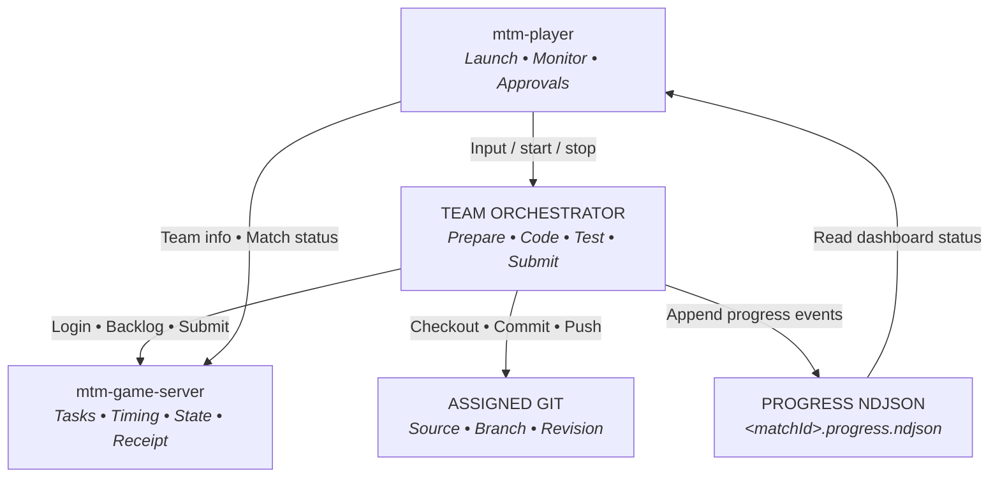
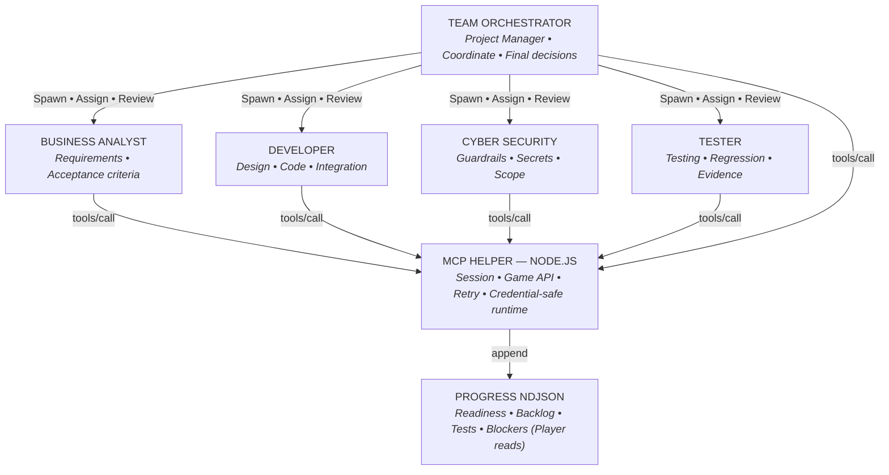

**MASTER THE MACHINE · CONTESTANT GUIDE**
# Build a Team Orchestrator for MTM
*Guide version: 0.5.1*
> **Ghi chú môi trường / Note:** Note: The current system can support both Codex and Claude Code. However, to provide a consistent and fair environment for competing Team Orchestrators, the organizers have selected Codex as the official competition environment. Therefore, please do not ask whether Claude Code can be used in the competition.
## Mục lục / Table of Contents

---

## 1. Game model {#section-1}



| Component | Role | Main inputs and outputs |
| --- | --- | --- |
| mtm-game-server | Provides the match, backlog, and assignment; manages time and status; receives submissions and returns receipts. Official grading and scores come from the organizer's system. | Account and session cookie for the match view; team bearer token for Start Work and Submit. Returns match, team, repository, backlog, operation endpoints, and receipts. |
| mtm-player | mtm-player initializes and checks the pack, runs the CLI and Team Orchestrator Agent, supplies phase-specific access, reads readiness, tracks match status, and handles stop, resume, approvals, and the dashboard. | Operator input: workspace, team, match, server access, and model/approval choices. Output to the Team Orchestrator Agent: preparation, game, control, and recovery data. |
| Team Orchestrator | Team-owned system: prepares source, reads the backlog, chooses work order, implements and tests, commits and pushes, calls Start Work and Submit, and reports progress. | Receives data from mtm-player and public tasks from the server; reports readiness and appends progress events. May use internal workers. |
| Assigned Git | Assigned source, branch, and folder; immutable revision for submission. | The Team Orchestrator Agent checks out, commits, and pushes within the assigned scope. |
| Progress NDJSON | Business status channel used by mtm-player to display preparation, backlog, tests, blockers, and API activity. | The team helper or Team Orchestrator Agent appends; mtm-player reads. Transcript text does not replace the log. |

> mtm-game-server decides match status and acceptance. The progress log reports team status, and the transcript does not replace mandatory logs.

## 2. Suggested orchestrator structure {#section-2}

The diagram proposes a Team Orchestrator acting as Project Manager with four specialist agents. The agents folder in the example pack follows the same structure: each TOML file has the corresponding agent name and a description. This is a reference structure; the registrations accepted by mtm-player may depend on its version. MCP Helper and Progress NDJSON are shared runtime components.



> ⚠️ **CẢNH BÁO / CHÚ Ý:** MUST NOT — The Team Orchestrator may spawn subagents only through the provider's native mechanism within the active CLI session. It must not launch additional Codex CLI, Claude Code CLI, app-server, or other independent CLI processes to perform match work.

| Module | Responsibility |
| --- | --- |
| Team Orchestrator Agent | Acts as Project Manager: receives lifecycle input, selects backlog work, assigns tasks, reviews results, integrates changes, and owns the final decision. |
| Business Analyst | Reads the backlog and clarifies requirements, acceptance criteria, constraints, and inputs for the Developer and Tester. |
| Developer | Explores the source, designs and implements changes, runs technical checks, and prepares the commit. |
| Cyber Security | Checks guardrails, workspace and network scope, credential handling, and actions that may cause violations. |
| Tester | Derives test scenarios from acceptance criteria, runs regression tests, and verifies results and evidence before submission. |
| MCP Helper — Node.js | Shared runtime for the session, in-memory cookie and bearer token, Game API, retry and idempotency, and progress-log appends. Agents call the helper instead of holding credentials or issuing HTTP requests themselves. |
| Progress NDJSON | Mandatory status file used by mtm-player to read readiness, backlog, tests, blockers, and API activity. MCP Helper appends one JSON object per line to the exact progressLogFile; the transcript does not replace this file. |

### Agent declaration structure

The following structure example corresponds to the Developer role in the diagram and uses the file `agents/team_developer.toml`.

<details>
<summary><b>agents/team_developer.toml — structure example</b></summary>

Copy

```toml
name = "team_developer"
description = "Developer agent profile."
```

</details>

The value of `name` must match the agent name in the filename (excluding the `.toml`extension). These profile files show declaration structure only; they contain no instructions or implementation source.

<details>
<summary><b>Source package and installed workspace folder layout</b></summary>

Copy

```text
team-orchestrator-pack-example/
  package.json
  team-pack-info.json
  team-runtime.json
  logs/MATCH_ID.progress.ndjson # empty file; replace MATCH_ID with the actual matchId
  README.md
  install.ps1
  agents/                      # root + four roles from section 2
    team-orchestrator.toml
    team-business-analyst.toml
    team-developer.toml
    team-cyber-security.toml
    team-tester.toml
  config/codex.toml
  skills/                      # instruction structure
    team-orchestrator/SKILL.md
    game-preparation/SKILL.md
    team-recovery/SKILL.md
  bin/runtime-server.mjs       # MCP Helper
  src/runtime-session.mjs
  contracts/progress-event.schema.json
  docs/README.md
  scripts/install.mjs
  scripts/check-distribution.mjs

The five agent files show the suggested structure in section 2. Each file contains only a matching name and description. This is an illustrative role structure; mtm-player registration compatibility depends on the installed mtm-player version. MCP Helper and Progress NDJSON are shared runtime components, not agent profiles.

After installation: <teamWorkspace>/
  matches/
    <matchId>/             # checkoutRoot: Git checkout, contains .git/
      <repository.folder>/ # matchRoot: assigned match subtree
        src/
        challenge/
        answers/
          <backlogId>/
            submit.json
            evidence/
  team-sdlc-pack/runtime/     # immutable payload
  team-sdlc-pack/logs/        # separate logs for each round/session
  .mtm/                      # team-runtime.json, team-pack-info.json
  .codex/agents/             # profile copies
  .codex/config.toml         # absolute MCP path
  .agents/skills/            # skill copies
```

#### team-pack-info.json — required file with a fixed structure

MUST create this file at the package root. Keep exactly the four fields shown; do not rename or add fields. schemaVersion remains 1. Set teamId and teamName to the code and name registered on mtm-game-server; teamId is not a UUID. Set version to the package version, matching package.json and team-runtime.json.

Copy

```json
{
  "schemaVersion": 1,
  "version": "1.0.0",
  "teamId": "HNKSUPER",
  "teamName": "HNK Super"
}
```

The example is HNKSUPER's identity. Other teams MUST replace it before building. The installer copies the file to team-sdlc-pack/runtime/team-pack-info.json and .mtm/team-pack-info.json in TeamWorkspace. mtm-player reads this identity when loading the team pack; both copies MUST match. See [section 5](#section-5) for character limits and naming rules.

</details>

### Checkout root and match root

Use the absolute paths supplied by mtm-player. `checkoutRoot` contains the Git checkout and `.git/`. `matchRoot = checkoutRoot/repository.folder` contains the assigned source, public challenge files, answers, and evidence. The repeated match ID in the example is intentional: the outer directory identifies the local checkout, and the inner directory comes from the server repository assignment.

Clone into `checkoutRoot`; build, test, and write answers inside `matchRoot`. A specialist worktree uses its own `worktreeRoot/repository.folder` as matchRoot. Pass both paths to the specialist. The compatibility field `challengeWorkspace` may point to `matches/`; use the explicit roots rather than treating that field as the source folder. Do not edit sibling match folders. Init/reset applies only to the selected match checkout; existing matches remain available. Resume uses the saved paths and preserves completed work.

### Helper tools to implement

| Suggested tool | Input | Output and behavior |
| --- | --- | --- |
| configure_session | descriptor, modelPolicy if present | Validate session and paths; preparation derives paths from trusted cwd; start retains the verified match session and repository while replacing the bearer client; resume replaces access from fresh input. |
| login_match | {} | Authenticate the cookie session; return only a safe status. |
| refresh_match | {} | Current match view; verify identity and repository; emit DISCOVERED for new items only during active play. |
| start_work | backlogItemKey | Return public requirements, template, and scenarios; log before and after HTTP calls. |
| submit_work | clientSubmissionId, backlogItemKey, gitRevision, answer | Return the official receipt; keep the UUID unchanged when the outcome is uncertain. |
| report_progress | event without the envelope | Add schemaVersion and playerSessionId and append a schema-valid event. |
| wait_for_update | timeoutMs ≤ 55000 | Bounded serial polling; return on a change or timeout; stop on control messages. |

Use newline-delimited JSON-RPC for MCP over stdin/stdout. Implement initialize, notifications/initialized, tools/list, and tools/call. Each tool in tools/list needs an inputSchema. Write only JSON-RPC to stdout; tool output is safe JSON in a text content block. Bound request time, response size, redirects, and origins.

## 3. From spawn to match end {#section-3}

> MUST log GAME_MASTER_API REQUESTED immediately before *every* login, refresh, Start Work, and Submit request; log SUCCEEDED or FAILED immediately after the result, including errors. The sequence names actions and data; the steps below detail inputs and outputs.

```mermaid
sequenceDiagram
    autonumber
    actor Player as mtm-player
    participant Orch as Orchestrator
    participant Server as mtm-game-server
    participant Git as Assigned Git
    participant Log as Progress log (<matchId>.progress.ndjson)

    Player->>Orch: 1. Spawn new Team Orchestrator Agent (team, match, repo, origins, models)
    Orch->>Log: 2. MUST: ORCHESTRATOR_STARTED (schemaVersion=1, playerSessionId, type)
    Orch->>Git: 3. Check Git auth -> checkout correct source
    Orch->>Log: 4. Install dependencies -> build -> baseline checks (PREPARATION_STATUS)
    Orch->>Server: 5. Log in at mtm-game-server URL provided by mtm-player
    Orch->>Server: 6. Access /match/<matchId> to verify task, team, repo
    Orch->>Log: 7. MUST: MATCH_LOGIN completed + ENVIRONMENT_READY
    Orch->>Player: 8. Return environment readiness (status=ENVIRONMENT_READY)
    Player->>Server: 9. Send Preparation Complete (PREPARED -> wait for IN_PROGRESS)
    Player->>Orch: 10. Grant permission to begin backlog work (bearer key, scopes, paths)
    Orch->>Server: 11. Read /match/<matchId> page (current backlog, instructions)
    Orch->>Log: 12. MUST: BACKLOG_SYNC completed; DISCOVERED each item
    Orch->>Server: 13. POST /api/v1/matches/<UUID>/backlogs/start {backlogItemKey: "TASK-01"}
    Server-->>Orch: Return template/scenarios (create answers/<ID>/submit.json & evidence/)
    Orch->>Log: 14. MUST: BACKLOG_STATUS IN_PROGRESS; BACKLOG_TESTS NOT_RUN
    Orch->>Orch: 15. Implement -> run tests -> finalize answer (test RUNNING -> PASSED/FAILED)
    Orch->>Git: 16. Commit and push to designated branch (full pushed Git SHA)
    Orch->>Server: 17. POST /api/v1/matches/<UUID>/submissions {clientSubmissionId, backlogItemKey, gitRevision, answer}
    Server-->>Orch: 18. Server returns receipt or error (receiptId, status=RECEIVED)
    Orch->>Log: 19. MUST: BACKLOG_STATUS SUBMITTED (revision + official receiptId)
    Player->>Orch: 20. Signal pause or match end (PAUSED / FINISHED / CANCELLED)
    Orch->>Log: 21. Stop API, Git, workers; log ORCHESTRATOR_ENDED (or wait for resume)
    Note over Player,Orch: 22. If resumed: mtm-player spawns replacement Orchestrator
    Orch->>Log: 23. MUST: ORCHESTRATOR_RESTARTED (reconcile log/Git/receipt; do not re-submit accepted items)
```

**MUST:** write logs to `<TeamWorkspace>/team-sdlc-pack/logs/<matchId>.progress.ndjson`. Example match: `ABCD1234.progress.ndjson`. When mtm-player supplies `progressLogFile`, MUST use that exact path; append one JSON object per line without overwriting the file.

### Step-by-step instructions

`[Team Orchestrator Agent: receive input]` `[mtm-player: provide input]` 

### 1. Receive input and initialize

The Team Orchestrator Agent receives session, team, match, repository, Git read access, account, password, allowed origins, and model policy. Read workspace AGENTS.md. No team bearer key is available in this step.

<details>
<summary><b>Complete preparation input</b></summary>

Copy

```json
{
  "schemaVersion": 1,
  "playerSessionId": "session-example",
  "teamId": "T01",
  "teamName": "Example Team",
  "matchId": "ABCD1234",
  "type": "PREPARE_GAME",
  "requestId": "prepare-example",
  "username": "example-account",
  "password": "FAKE_PASSWORD_FOR_EXAMPLE",
  "matchPageUrl": "https://ai-fest-five.vercel.app/match",
  "allowedMatchOrigins": [
    "https://ai-fest-five.vercel.app"
  ],
  "repository": {
    "url": "https://github.com/example/repo.git",
    "branch": "main",
    "folder": "ABCD1234"
  },
  "hostAuthorization": {
    "schemaVersion": 1,
    "type": "MTM_PREPARATION_HOST_AUTHORIZATION",
    "authority": "ORGANIZER_DECLARED_SCOPE",
    "playerSessionId": "session-example",
    "matchId": "ABCD1234",
    "inheritance": "ORCHESTRATOR_TREE",
    "enforcement": "TEAM_RESPONSIBILITY",
    "taskPermissions": "INHERIT",
    "credentialUse": "HOST_GIT_CREDENTIAL_TO_ASSIGNED_REPOSITORY_ONLY",
    "repository": {
      "url": "https://github.com/example/repo.git",
      "branch": "main",
      "folder": "ABCD1234"
    },
    "gitOperations": [
      "READ_ASSIGNED_REPOSITORY",
      "CLONE_ASSIGNED_BRANCH",
      "FETCH_ASSIGNED_BRANCH"
    ]
  },
  "checkoutRoot": "D:/mtm/T01/matches/ABCD1234",
  "matchRoot": "D:/mtm/T01/matches/ABCD1234/ABCD1234"
}
```

</details>

<details>
<summary><b>First log event — MUST</b></summary>

**MUST write to file:** `<TeamWorkspace>/team-sdlc-pack/logs/<matchId>.progress.ndjson`Example: `D:/mtm/T01/team-sdlc-pack/logs/ABCD1234.progress.ndjson`.Use the exact `progressLogFile` for the current session when supplied. **Append content:** The JSON below plus one newline (UTF-8). Do not overwrite the file. Replace playerSessionId and sample values with real session data.Copy

```ndjson
{"schemaVersion":1,"playerSessionId":"session-example","type":"ORCHESTRATOR_STARTED","summary":"Orchestrator started."}
```

</details>

`[Team Orchestrator Agent: checkout source]` 

### 2. Source Check Out

The Team Orchestrator Agent checks host-provided Git access and checks out the assigned repository, branch, and folder under challenge. MUST append PREPARATION_STATUS for GIT_AUTH and REPOSITORY when each check starts and ends; report COMPLETED only after verifying source and revision. Do not push during preparation.

**MUST write to file:** `<TeamWorkspace>/team-sdlc-pack/logs/<matchId>.progress.ndjson`Example: `D:/mtm/T01/team-sdlc-pack/logs/ABCD1234.progress.ndjson`.Use the exact `progressLogFile` for the current session when supplied. **Append content:** The JSON below plus one newline (UTF-8). Do not overwrite the file. Replace playerSessionId and sample values with real session data.Copy

```ndjson
{"schemaVersion":1,"playerSessionId":"session-example","type":"PREPARATION_STATUS","stage":"GIT_AUTH","status":"COMPLETED","summary":"Git access to the assigned repository verified."}
```

**MUST write to file:** `<TeamWorkspace>/team-sdlc-pack/logs/<matchId>.progress.ndjson`Example: `D:/mtm/T01/team-sdlc-pack/logs/ABCD1234.progress.ndjson`.Use the exact `progressLogFile` for the current session when supplied. **Append content:** The JSON below plus one newline (UTF-8). Do not overwrite the file. Replace playerSessionId and sample values with real session data.Copy

```ndjson
{"schemaVersion":1,"playerSessionId":"session-example","type":"PREPARATION_STATUS","stage":"REPOSITORY","status":"COMPLETED","summary":"Checked out the assigned repository, branch, folder, and revision."}
```

`[Team Orchestrator Agent: set up environment and build]` 

### 3. Environment Setup

The Team Orchestrator Agent checks Git, Node.js/npm, or the toolchain actually required by the source; installs locked dependencies; runs baseline tests and the build. MUST append PREPARATION_STATUS for ENVIRONMENT and BUILD at the start and end of each check. Report COMPLETED only for real success; report FAILED/BLOCKED on failure and do not emit ENVIRONMENT_READY.

**MUST write to file:** `<TeamWorkspace>/team-sdlc-pack/logs/<matchId>.progress.ndjson`Example: `D:/mtm/T01/team-sdlc-pack/logs/ABCD1234.progress.ndjson`.Use the exact `progressLogFile` for the current session when supplied. **Append content:** The JSON below plus one newline (UTF-8). Do not overwrite the file. Replace playerSessionId and sample values with real session data.Copy

```ndjson
{"schemaVersion":1,"playerSessionId":"session-example","type":"PREPARATION_STATUS","stage":"ENVIRONMENT","status":"COMPLETED","summary":"Required toolchain and dependencies are ready."}
```

**MUST write to file:** `<TeamWorkspace>/team-sdlc-pack/logs/<matchId>.progress.ndjson`Example: `D:/mtm/T01/team-sdlc-pack/logs/ABCD1234.progress.ndjson`.Use the exact `progressLogFile` for the current session when supplied. **Append content:** The JSON below plus one newline (UTF-8). Do not overwrite the file. Replace playerSessionId and sample values with real session data.Copy

```ndjson
{"schemaVersion":1,"playerSessionId":"session-example","type":"PREPARATION_STATUS","stage":"BUILD","status":"COMPLETED","summary":"Baseline checks and build passed."}
```

`[Team Orchestrator Agent: log in]` `[mtm-game-server: authenticate]` 

### 4. Log in to mtm-game-server

Open the mtm-game-server URL supplied by mtm-player. Log in with the supplied username and password. Then explicitly open the page for the assigned matchId; do not rely on the default redirect.

Copy

```text
Example URL: https://ai-fest-five.vercel.app/
Username: username supplied by mtm-player
Password: password supplied by mtm-player
```

`[Team Orchestrator Agent: read and verify]` `[mtm-game-server: display information]` 

### 5. Open the exact match and verify assignment

After logging in, visit /match/<matchId> on the same mtm-game-server. For example, matchId ABCD1234 means https://ai-fest-five.vercel.app/match/ABCD1234. Read the match, team, repository/branch/folder, and backlog shown there. Verify them against mtm-player input. During preparation, verify access and assignment only; do not start backlog work.

> MUST open the page for the exact matchId; the generic /match page does not identify the task. Output is the visible match information and authorized backlog, without requiring a specific internal API response.

`[Team Orchestrator Agent: write readiness log]` `[mtm-player: read and validate the log]` 

### 6. Write the readiness log

MUST log MATCH_LOGIN completed, then append an ENVIRONMENT_READY event to the exact progressLogFile through the team's progress writer/helper. mtm-player polls the log file, validates the event, and handles the required steps with mtm-game-server. The Team Orchestrator Agent does not send this JSON to an mtm-player API or need a parent task to forward it. The CLI final response may repeat the result for the reader; it does not replace the mandatory log.

<details>
<summary><b>JSON appended to progress.ndjson — MUST; this is the channel to mtm-player</b></summary>

**MUST write to file:** `<TeamWorkspace>/team-sdlc-pack/logs/<matchId>.progress.ndjson`Example: `D:/mtm/T01/team-sdlc-pack/logs/ABCD1234.progress.ndjson`.Use the exact `progressLogFile` for the current session when supplied. **Append content:** The JSON below plus one newline (UTF-8). Do not overwrite the file. Replace playerSessionId and sample values with real session data.Copy

```ndjson
{"schemaVersion":1,"playerSessionId":"session-example","type":"ENVIRONMENT_READY","requestId":"prepare-example","repository":{"url":"https://github.com/example/repo.git","branch":"main","folder":"ABCD1234"},"revision":"0123456789abcdef0123456789abcdef01234567","build":"PASS","matchLogin":"PASS"}
```

</details>

<details>
<summary><b>Information mtm-player reads and validates from the log</b></summary>

Copy

```json
{
  "schemaVersion": 1,
  "status": "ENVIRONMENT_READY",
  "requestId": "prepare-example",
  "repository": {
    "url": "https://github.com/example/repo.git",
    "branch": "main",
    "folder": "ABCD1234"
  },
  "revision": "0123456789abcdef0123456789abcdef01234567",
  "build": "PASS",
  "matchLogin": "PASS"
}
```

</details>

<details>
<summary><b>How mtm-player handles readiness</b></summary>

mtm-player verifies the repository, revision, build, and login status from the progress log. When the data is valid, mtm-player informs mtm-game-server that the environment is ready, stores the result, and updates the preparation milestone. The Team Orchestrator Agent only needs to write the correct log; it does not perform mtm-player's operation.

</details>

> Flow: Team Orchestrator Agent → helper appends ENVIRONMENT_READY → progressLogFile → mtm-player polls and validates → mtm-player handles readiness with mtm-game-server. If the append does not succeed, mtm-player has not received readiness even if the transcript says preparation is complete.

`[mtm-player: send Preparation Complete]` `[mtm-game-server: confirm PREPARED]` 

### 7. Wait for mtm-player to acknowledge preparation

mtm-player verifies readiness, reports preparation status to mtm-game-server, and waits for the system to accept it. The Team Orchestrator Agent does not perform this operation or write the milestone owned by mtm-player. Begin backlog work only after mtm-player supplies active-game input.

> There is no separate operator command to start backlogs after preparation completes.

`[mtm-player: provide active-game input]` `[Team Orchestrator Agent: receive and validate]` 

### 8. Receive active-game access

Validate environmentRevision, bearer UTF-8 length and SHA-256, origins, scopes, paths, and hostAuthorization. The helper retains repository and account information from preparation; start does not repeat them.

<details>
<summary><b>Complete active-game input; sample key is fake</b></summary>

Copy

```json
{
  "schemaVersion": 1,
  "playerSessionId": "session-example",
  "teamId": "T01",
  "teamName": "Example Team",
  "matchId": "ABCD1234",
  "type": "START_GAME",
  "requestId": "start-example",
  "teamUuid": "22222222-2222-4222-8222-222222222222",
  "gameMasterApiUrl": "https://ai-fest-five.vercel.app/",
  "apiKeySecret": "FAKE_TEAM_KEY_FOR_EXAMPLE",
  "apiKeyLength": 25,
  "apiKeySha256": "e7d23ff3be50646498fa0736d7d6d1483834f265b620fd566b72cb98a98294c6",
  "apiKeyScopes": [
    "backlogs:start",
    "submissions:create"
  ],
  "gameMasterUrl": "https://ai-fest-five.vercel.app/",
  "matchPageUrl": "https://ai-fest-five.vercel.app/match",
  "teamInfoRequestId": "team-info-example",
  "allowedApiOrigins": [
    "https://ai-fest-five.vercel.app"
  ],
  "teamWorkspace": "D:/mtm/T01",
  "challengeWorkspace": "D:/mtm/T01/matches",
  "teamSdlcPackWorkspace": "D:/mtm/T01/team-sdlc-pack",
  "progressLogFile": "D:/mtm/T01/team-sdlc-pack/logs/ABCD1234.progress.ndjson",
  "environmentRevision": "0123456789abcdef0123456789abcdef01234567",
  "hostAuthorization": {
    "schemaVersion": 1,
    "type": "MTM_HOST_AUTHORIZATION",
    "authority": "ORGANIZER_DECLARED_SCOPE",
    "playerSessionId": "session-example",
    "matchId": "ABCD1234",
    "inheritance": "ORCHESTRATOR_TREE",
    "enforcement": "TEAM_RESPONSIBILITY",
    "taskPermissions": "INHERIT",
    "credentialUse": "TEAM_BEARER_TO_GAME_MASTER_ONLY",
    "allowedOrigins": [
      "https://ai-fest-five.vercel.app"
    ],
    "apiScopes": [
      "backlogs:start",
      "submissions:create"
    ],
    "apiOperations": [
      {
        "operation": "START_WORK",
        "method": "POST",
        "pathTemplate": "/api/v1/matches/{matchUuid}/backlogs/start"
      },
      {
        "operation": "SUBMIT",
        "method": "POST",
        "pathTemplate": "/api/v1/matches/{matchUuid}/submissions"
      }
    ],
    "gitOperations": [
      "COMMIT_ASSIGNED_REPOSITORY",
      "PUSH_ASSIGNED_BRANCH"
    ]
  },
  "gitPolicy": {
    "commitAssignedRepository": true,
    "pushAssignedRepository": true,
    "forcePush": false,
    "mutateRemote": false,
    "authentication": "ASK_USER"
  },
  "checkoutRoot": "D:/mtm/T01/matches/ABCD1234",
  "matchRoot": "D:/mtm/T01/matches/ABCD1234/ABCD1234"
}
```

</details>

`[Team Orchestrator Agent: synchronize backlog and write logs]` 

### 9. Synchronize and report the backlog

Reopen /match/<matchId>; report BACKLOG_SYNC in progress and completed. MUST log DISCOVERED for each new visible item, including unselected work. Do not duplicate an event already emitted by the background helper.

**MUST write to file:** `<TeamWorkspace>/team-sdlc-pack/logs/<matchId>.progress.ndjson`Example: `D:/mtm/T01/team-sdlc-pack/logs/ABCD1234.progress.ndjson`.Use the exact `progressLogFile` for the current session when supplied. **Append content:** The JSON below plus one newline (UTF-8). Do not overwrite the file. Replace playerSessionId and sample values with real session data.Copy

```ndjson
{"schemaVersion":1,"playerSessionId":"session-example","type":"GAME_START_STATUS","stage":"BACKLOG_SYNC","status":"COMPLETED","summary":"Retrieved the current backlog."}
```

**MUST write to file:** `<TeamWorkspace>/team-sdlc-pack/logs/<matchId>.progress.ndjson`Example: `D:/mtm/T01/team-sdlc-pack/logs/ABCD1234.progress.ndjson`.Use the exact `progressLogFile` for the current session when supplied. **Append content:** The JSON below plus one newline (UTF-8). Do not overwrite the file. Replace playerSessionId and sample values with real session data.Copy

```ndjson
{"schemaVersion":1,"playerSessionId":"session-example","type":"BACKLOG_STATUS","backlogId":"TASK-01","title":"Fix customer search","status":"DISCOVERED","summary":"Work status updated.","revision":null,"receiptId":null}
```

`[Team Orchestrator Agent: call Start Work]` `[mtm-game-server: accept and return the task]` 

### 10. Start Work before editing

The Team Orchestrator Agent calls POST /api/v1/matches/<match.id UUID>/backlogs/start on mtm-game-server to begin one backlog item. Send the team bearer key in Authorization and the selected backlogItemKey in the JSON body. mtm-game-server confirms Start Work and returns the template and scenarios. Only after acceptance does the Team Orchestrator Agent log IN_PROGRESS and begin editing source. Accept and Content-Type are application/json.

Copy

```json
{
  "backlogItemKey": "TASK-01"
}
```

<details>
<summary><b>Illustrative output; use the actual response template and scenarios</b></summary>

Copy

```json
{
  "backlogId": "TASK-01",
  "backlogType": "TASK",
  "replay": false,
  "submitTemplate": {
    "backlogId": "TASK-01",
    "status": "NOT_STARTED",
    "evidenceFiles": []
  },
  "minimumVerificationScenarios": null,
  "files": {
    "challenge/TASK-01-submit.json": "{ ...template JSON... }"
  }
}
```

</details>

> **MUST — Canonical submission paths:** A file such as `challenge/TASK-01-submit.json` returned by Start Work is a source template only. Copy its content to `<repository.folder>/answers/TASK-01/submit.json`. Store every evidence file in `<repository.folder>/answers/TASK-01/evidence/` and reference it in JSON as `evidence/<filename>`. Never create or commit evidence under `<repository.folder>/evidence/` or `<repository.folder>/challenge/evidence/`. The team may enforce this contract with MCP, a helper, or another implementation.

**MUST write to file:** `<TeamWorkspace>/team-sdlc-pack/logs/<matchId>.progress.ndjson`Example: `D:/mtm/T01/team-sdlc-pack/logs/ABCD1234.progress.ndjson`.Use the exact `progressLogFile` for the current session when supplied. **Append content:** The JSON below plus one newline (UTF-8). Do not overwrite the file. Replace playerSessionId and sample values with real session data.Copy

```ndjson
{"schemaVersion":1,"playerSessionId":"session-example","type":"GAME_MASTER_API","operation":"START_WORK","backlogId":"TASK-01","method":"POST","origin":"https://ai-fest-five.vercel.app","path":"/api/v1/matches/11111111-1111-4111-8111-111111111111/backlogs/start","phase":"REQUESTED","httpStatus":null,"requestId":null,"summary":"Calling mtm-game-server."}
```

**MUST write to file:** `<TeamWorkspace>/team-sdlc-pack/logs/<matchId>.progress.ndjson`Example: `D:/mtm/T01/team-sdlc-pack/logs/ABCD1234.progress.ndjson`.Use the exact `progressLogFile` for the current session when supplied. **Append content:** The JSON below plus one newline (UTF-8). Do not overwrite the file. Replace playerSessionId and sample values with real session data.Copy

```ndjson
{"schemaVersion":1,"playerSessionId":"session-example","type":"GAME_MASTER_API","operation":"START_WORK","backlogId":"TASK-01","method":"POST","origin":"https://ai-fest-five.vercel.app","path":"/api/v1/matches/11111111-1111-4111-8111-111111111111/backlogs/start","phase":"SUCCEEDED","httpStatus":200,"requestId":"req-start","summary":"Received the mtm-game-server result."}
```

`[Team Orchestrator Agent: implement and test]` 

Before submitting, verify the exact Git revision contains `<repository.folder>/answers/<backlogId>/submit.json` and every referenced evidence file under its `evidence/` directory. Finding files at repository-root `answers/` is insufficient. Local writes use `matchRoot/answers/…`; Git checks use paths relative to `checkoutRoot`. Relative JSON references remain `evidence/<filename>`.

### 11. Implement, test, and complete the answer

Log IN_PROGRESS and BACKLOG_TESTS NOT_RUN; edit source; run required scenarios and relevant regression tests. In `submit.json`, evidence paths are relative to the backlog answer directory, for example `evidence/TASK-01-TC-01.json`; do not include `answers/TASK-01/` in those JSON values. Report RUNNING and then PASSED/FAILED with real counts. If blocked, log BLOCKER_OPENED; when resolved, log BLOCKER_RESOLVED with the same ID.

**MUST write to file:** `<TeamWorkspace>/team-sdlc-pack/logs/<matchId>.progress.ndjson`Example: `D:/mtm/T01/team-sdlc-pack/logs/ABCD1234.progress.ndjson`.Use the exact `progressLogFile` for the current session when supplied. **Append content:** The JSON below plus one newline (UTF-8). Do not overwrite the file. Replace playerSessionId and sample values with real session data.Copy

```ndjson
{"schemaVersion":1,"playerSessionId":"session-example","type":"BACKLOG_TESTS","backlogId":"TASK-01","status":"NOT_RUN","required":2,"executed":0,"passed":0,"failed":0,"skipped":0,"summary":"Tests have not run."}
```

**MUST write to file:** `<TeamWorkspace>/team-sdlc-pack/logs/<matchId>.progress.ndjson`Example: `D:/mtm/T01/team-sdlc-pack/logs/ABCD1234.progress.ndjson`.Use the exact `progressLogFile` for the current session when supplied. **Append content:** The JSON below plus one newline (UTF-8). Do not overwrite the file. Replace playerSessionId and sample values with real session data.Copy

```ndjson
{"schemaVersion":1,"playerSessionId":"session-example","type":"BACKLOG_TESTS","backlogId":"TASK-01","status":"PASSED","required":2,"executed":2,"passed":2,"failed":0,"skipped":0,"summary":"Both required tests passed."}
```

`[Team Orchestrator Agent: commit and push]` 

### 12. Commit and push to the assigned branch

Complete the answer using the template. Commit source, tests, evidence, and answer together; push to the assigned repository and branch; obtain the full 40- or 64-character SHA. Do not submit an ambiguous HEAD reference.

> The answer does not contain gitRevision; the SHA belongs at the top level of the submission request.

`[Team Orchestrator Agent: send submission]` `[mtm-game-server: receive submission]` 

### 13. Submit the work

The Team Orchestrator Agent calls POST /api/v1/matches/<match.id UUID>/submissions on mtm-game-server to submit the completed backlog item. The JSON body contains clientSubmissionId, backlogItemKey, gitRevision, and answer. Send the team bearer key in Authorization, use JSON headers, and set Idempotency-Key to clientSubmissionId. Log REQUESTED immediately before the call and its outcome immediately after the response.

Copy

```json
{
  "clientSubmissionId": "33333333-3333-4333-8333-333333333333",
  "backlogItemKey": "TASK-01",
  "gitRevision": "0123456789abcdef0123456789abcdef01234567",
  "answer": {
    "backlogId": "TASK-01",
    "status": "SUBMITTED",
    "changeSummary": "Fixed search and tested the required scenarios."
  }
}
```

Copy

```http
Authorization: Bearer <runtime team key>
Accept: application/json
Content-Type: application/json
Idempotency-Key: 33333333-3333-4333-8333-333333333333
```

`[mtm-game-server: return receipt]` `[Team Orchestrator Agent: ghi SUBMITTED]` 

### 14. Receive the receipt and update the log

mtm-game-server returns a receiptId and submission intake status (such as RECEIVED). The receipt confirms intake, not grading. The Team Orchestrator Agent MUST log BACKLOG_STATUS SUBMITTED with the full Git SHA and official receiptId so mtm-player can display it. HTTP 2xx without an acceptance receipt is not enough to report SUBMITTED.

Copy

```json
{
  "receiptId": "receipt-123",
  "status": "RECEIVED"
}
```

**MUST write to file:** `<TeamWorkspace>/team-sdlc-pack/logs/<matchId>.progress.ndjson`Example: `D:/mtm/T01/team-sdlc-pack/logs/ABCD1234.progress.ndjson`.Use the exact `progressLogFile` for the current session when supplied. **Append content:** The JSON below plus one newline (UTF-8). Do not overwrite the file. Replace playerSessionId and sample values with real session data.Copy

```ndjson
{"schemaVersion":1,"playerSessionId":"session-example","type":"BACKLOG_STATUS","backlogId":"TASK-01","title":"Fix customer search","status":"SUBMITTED","summary":"Work status updated.","revision":"0123456789abcdef0123456789abcdef01234567","receiptId":"receipt-123"}
```

`[Team Orchestrator Agent: continue or wait]` 

### 15. Repeat while the match is active

Refresh after each submission. Choose the next item or wait for publication; use bounded, non-overlapping polling. Example helper cadence: 5 seconds after success, 10 after an error. The Team Orchestrator Agent waits up to 55 seconds per tool call before checking again.

> On submit timeout, preserve the UUID and body; reconcile or retry with the same idempotency key. Empty backlog, expired login, or temporary access issues are waiting/blocker states, not match completion.

`[mtm-player: send pause/end]` `[Team Orchestrator Agent: stop work]` 

### 16. Pause, end, and stop

mtm-player sends session, match, and matchStatus. Stop new API, Git, tool, worker, and polling activity and pack-owned processes; preserve source and evidence. Do not log ORCHESTRATOR_ENDED for a pause. At match end, log the event if possible; do not submit further work.

<details>
<summary><b>Input pause</b></summary>

Copy

```json
{
  "schemaVersion": 1,
  "type": "MATCH_PAUSED",
  "playerSessionId": "session-example",
  "matchId": "ABCD1234",
  "matchStatus": "PAUSED"
}
```

</details>

<details>
<summary><b>End input</b></summary>

Copy

```json
{
  "schemaVersion": 1,
  "type": "MATCH_ENDED",
  "playerSessionId": "session-example",
  "matchId": "ABCD1234",
  "matchStatus": "FINISHED"
}
```

</details>

**MUST write to file:** `<TeamWorkspace>/team-sdlc-pack/logs/<matchId>.progress.ndjson`Example: `D:/mtm/T01/team-sdlc-pack/logs/ABCD1234.progress.ndjson`.Use the exact `progressLogFile` for the current session when supplied. **Append content:** The JSON below plus one newline (UTF-8). Do not overwrite the file. Replace playerSessionId and sample values with real session data.Copy

```ndjson
{"schemaVersion":1,"playerSessionId":"session-example","type":"ORCHESTRATOR_ENDED","status":"COMPLETED","summary":"The match has ended; all activity has stopped."}
```

> COMPLETED is a valid status for the ORCHESTRATOR_ENDED log event. The separate final result schema currently accepts only SUBMITTED/BLOCKED/FAILED; do not return COMPLETED in that schema.

`[mtm-player: start a replacement session]` `[Team Orchestrator Agent: reconcile and resume]` 

### 17. Resume the same round when mtm-player requests it

mtm-player starts a replacement Team Orchestrator Agent with fresh access, repository, paths, restartAttempt, and reason. Read the existing log and reconcile Git and receipts before retrying; MUST log ORCHESTRATOR_RESTARTED. A new init is a new round even if it uses the same public match code.

<details>
<summary><b>Complete resume-game input</b></summary>

Copy

```json
{
  "schemaVersion": 1,
  "playerSessionId": "session-example",
  "teamId": "T01",
  "teamName": "Example Team",
  "matchId": "ABCD1234",
  "type": "RESUME_GAME",
  "requestId": "restart-session-example-1",
  "restartAttempt": 1,
  "reason": "OPERATOR_RESUME",
  "teamUuid": "22222222-2222-4222-8222-222222222222",
  "username": "example-account",
  "password": "FAKE_PASSWORD_FOR_EXAMPLE",
  "gameMasterUrl": "https://ai-fest-five.vercel.app/",
  "matchPageUrl": "https://ai-fest-five.vercel.app/match",
  "allowedMatchOrigins": [
    "https://ai-fest-five.vercel.app"
  ],
  "repository": {
    "url": "https://github.com/example/repo.git",
    "branch": "main",
    "folder": "ABCD1234"
  },
  "teamWorkspace": "D:/mtm/T01",
  "challengeWorkspace": "D:/mtm/T01/matches",
  "teamSdlcPackWorkspace": "D:/mtm/T01/team-sdlc-pack",
  "progressLogFile": "D:/mtm/T01/team-sdlc-pack/logs/ABCD1234.progress.ndjson",
  "environmentRevision": "0123456789abcdef0123456789abcdef01234567",
  "gameMasterApiUrl": "https://ai-fest-five.vercel.app/",
  "apiKeySecret": "FAKE_TEAM_KEY_FOR_EXAMPLE",
  "apiKeyLength": 25,
  "apiKeySha256": "e7d23ff3be50646498fa0736d7d6d1483834f265b620fd566b72cb98a98294c6",
  "apiKeyScopes": [
    "backlogs:start",
    "submissions:create"
  ],
  "teamInfoRequestId": "team-info-example",
  "allowedApiOrigins": [
    "https://ai-fest-five.vercel.app"
  ],
  "hostAuthorization": {
    "schemaVersion": 1,
    "type": "MTM_HOST_AUTHORIZATION",
    "authority": "ORGANIZER_DECLARED_SCOPE",
    "playerSessionId": "session-example",
    "matchId": "ABCD1234",
    "inheritance": "ORCHESTRATOR_TREE",
    "enforcement": "TEAM_RESPONSIBILITY",
    "taskPermissions": "INHERIT",
    "credentialUse": "TEAM_BEARER_TO_GAME_MASTER_ONLY",
    "allowedOrigins": [
      "https://ai-fest-five.vercel.app"
    ],
    "apiScopes": [
      "backlogs:start",
      "submissions:create"
    ],
    "apiOperations": [
      {
        "operation": "START_WORK",
        "method": "POST",
        "pathTemplate": "/api/v1/matches/{matchUuid}/backlogs/start"
      },
      {
        "operation": "SUBMIT",
        "method": "POST",
        "pathTemplate": "/api/v1/matches/{matchUuid}/submissions"
      }
    ],
    "gitOperations": [
      "COMMIT_ASSIGNED_REPOSITORY",
      "PUSH_ASSIGNED_BRANCH"
    ]
  },
  "gitPolicy": {
    "commitAssignedRepository": true,
    "pushAssignedRepository": true,
    "forcePush": false,
    "mutateRemote": false,
    "authentication": "ASK_USER"
  },
  "checkoutRoot": "D:/mtm/T01/matches/ABCD1234",
  "matchRoot": "D:/mtm/T01/matches/ABCD1234/ABCD1234"
}
```

</details>

<details>
<summary><b>Complete resume-preparation input</b></summary>

Copy

```json
{
  "schemaVersion": 1,
  "playerSessionId": "session-example",
  "teamId": "T01",
  "teamName": "Example Team",
  "matchId": "ABCD1234",
  "type": "RESUME_PREPARATION",
  "requestId": "restart-session-example-1",
  "restartAttempt": 1,
  "reason": "OPERATOR_RESUME",
  "teamUuid": "22222222-2222-4222-8222-222222222222",
  "username": "example-account",
  "password": "FAKE_PASSWORD_FOR_EXAMPLE",
  "gameMasterUrl": "https://ai-fest-five.vercel.app/",
  "matchPageUrl": "https://ai-fest-five.vercel.app/match",
  "allowedMatchOrigins": [
    "https://ai-fest-five.vercel.app"
  ],
  "repository": {
    "url": "https://github.com/example/repo.git",
    "branch": "main",
    "folder": "ABCD1234"
  },
  "teamWorkspace": "D:/mtm/T01",
  "challengeWorkspace": "D:/mtm/T01/matches",
  "teamSdlcPackWorkspace": "D:/mtm/T01/team-sdlc-pack",
  "progressLogFile": "D:/mtm/T01/team-sdlc-pack/logs/ABCD1234.progress.ndjson",
  "environmentRevision": null,
  "checkoutRoot": "D:/mtm/T01/matches/ABCD1234",
  "matchRoot": "D:/mtm/T01/matches/ABCD1234/ABCD1234"
}
```

</details>

**MUST write to file:** `<TeamWorkspace>/team-sdlc-pack/logs/<matchId>.progress.ndjson`Example: `D:/mtm/T01/team-sdlc-pack/logs/ABCD1234.progress.ndjson`.Use the exact `progressLogFile` for the current session when supplied. **Append content:** The JSON below plus one newline (UTF-8). Do not overwrite the file. Replace playerSessionId and sample values with real session data.Copy

```ndjson
{"schemaVersion":1,"playerSessionId":"session-example","type":"ORCHESTRATOR_RESTARTED","attempt":1,"phase":"GAME","reason":"OPERATOR_RESUME","summary":"Reconciled state before continuing."}
```

### Mandatory log rules

Append one UTF-8 JSON object per line to **the exact progressLogFile**. The envelope contains schemaVersion=1, the current playerSessionId, and the canonical type. Do not add timestamps or arbitrary fields. Include all required fields, even null and zero. mtm-player owns PREPARE_COMPLETE; team code does not log this milestone.

| When | Event MUST | Required content |
| --- | --- | --- |
| Fresh Team Orchestrator Agent | ORCHESTRATOR_STARTED | summary; first event, only once. |
| Preparation steps | PREPARATION_STATUS | stage GIT_AUTH/REPOSITORY/ENVIRONMENT/BUILD/MATCH_LOGIN; status IN_PROGRESS/COMPLETED/BLOCKED/FAILED; summary. |
| Build and login verified | ENVIRONMENT_READY | requestId, repository URL/branch/folder, revision, build PASS, matchLogin PASS. |
| Initial backlog sync | GAME_START_STATUS | stage BACKLOG_SYNC, status, summary. |
| Discover / state changes | BACKLOG_STATUS | backlogId, title, status, summary, revision, receiptId; SUBMITTED needs a real receipt. |
| Before, during, and after testing | BACKLOG_TESTS | backlogId, status, required/executed/passed/failed/skipped, summary; do not estimate counts. |
| Before and after API calls | GAME_MASTER_API | operation, backlogId/null, method, origin, path, phase, httpStatus/null, requestId/null, summary. |
| Blocked / recover | BLOCKER_OPENED / BLOCKER_RESOLVED | stable blockerId; OPENED also needs backlogId/null and summary. |
| Replacement Team Orchestrator Agent | ORCHESTRATOR_RESTARTED | attempt, phase PREPARATION/GAME, reason, summary. |
| Match end or unrecoverable contract failure | ORCHESTRATOR_ENDED | status COMPLETED/BLOCKED/FAILED and summary; do not log merely for pause or wait. |

<details>
<summary><b>Complete NDJSON lines for implementation checks</b></summary>

**MUST write to file:** `<TeamWorkspace>/team-sdlc-pack/logs/<matchId>.progress.ndjson`Example: `D:/mtm/T01/team-sdlc-pack/logs/ABCD1234.progress.ndjson`.Use the exact `progressLogFile` for the current session when supplied. **Append content:** The JSON below plus one newline (UTF-8). Do not overwrite the file. Replace playerSessionId and sample values with real session data.Copy

```ndjson
{"schemaVersion":1,"playerSessionId":"session-example","type":"ORCHESTRATOR_STARTED","summary":"Orchestrator started."}
{"schemaVersion":1,"playerSessionId":"session-example","type":"PREPARATION_STATUS","stage":"BUILD","status":"COMPLETED","summary":"Build passed."}
{"schemaVersion":1,"playerSessionId":"session-example","type":"ENVIRONMENT_READY","requestId":"prepare-example","repository":{"url":"https://github.com/example/repo.git","branch":"main","folder":"ABCD1234"},"revision":"0123456789abcdef0123456789abcdef01234567","build":"PASS","matchLogin":"PASS"}
{"schemaVersion":1,"playerSessionId":"session-example","type":"GAME_START_STATUS","stage":"BACKLOG_SYNC","status":"COMPLETED","summary":"Retrieved the current backlog."}
{"schemaVersion":1,"playerSessionId":"session-example","type":"BACKLOG_STATUS","backlogId":"TASK-01","title":"Fix customer search","status":"DISCOVERED","summary":"Work status updated.","revision":null,"receiptId":null}
{"schemaVersion":1,"playerSessionId":"session-example","type":"GAME_MASTER_API","operation":"START_WORK","backlogId":"TASK-01","method":"POST","origin":"https://ai-fest-five.vercel.app","path":"/api/v1/matches/11111111-1111-4111-8111-111111111111/backlogs/start","phase":"REQUESTED","httpStatus":null,"requestId":null,"summary":"Calling mtm-game-server."}
{"schemaVersion":1,"playerSessionId":"session-example","type":"GAME_MASTER_API","operation":"START_WORK","backlogId":"TASK-01","method":"POST","origin":"https://ai-fest-five.vercel.app","path":"/api/v1/matches/11111111-1111-4111-8111-111111111111/backlogs/start","phase":"SUCCEEDED","httpStatus":200,"requestId":"req-start","summary":"Received the mtm-game-server result."}
{"schemaVersion":1,"playerSessionId":"session-example","type":"BACKLOG_STATUS","backlogId":"TASK-01","title":"Fix customer search","status":"IN_PROGRESS","summary":"Work status updated.","revision":null,"receiptId":null}
{"schemaVersion":1,"playerSessionId":"session-example","type":"BACKLOG_TESTS","backlogId":"TASK-01","status":"NOT_RUN","required":2,"executed":0,"passed":0,"failed":0,"skipped":0,"summary":"Tests have not run."}
{"schemaVersion":1,"playerSessionId":"session-example","type":"BACKLOG_TESTS","backlogId":"TASK-01","status":"PASSED","required":2,"executed":2,"passed":2,"failed":0,"skipped":0,"summary":"Both required tests passed."}
{"schemaVersion":1,"playerSessionId":"session-example","type":"GAME_MASTER_API","operation":"SUBMIT","backlogId":"TASK-01","method":"POST","origin":"https://ai-fest-five.vercel.app","path":"/api/v1/matches/11111111-1111-4111-8111-111111111111/submissions","phase":"REQUESTED","httpStatus":null,"requestId":null,"summary":"Calling mtm-game-server."}
{"schemaVersion":1,"playerSessionId":"session-example","type":"GAME_MASTER_API","operation":"SUBMIT","backlogId":"TASK-01","method":"POST","origin":"https://ai-fest-five.vercel.app","path":"/api/v1/matches/11111111-1111-4111-8111-111111111111/submissions","phase":"SUCCEEDED","httpStatus":200,"requestId":"req-submit","summary":"Received the mtm-game-server result."}
{"schemaVersion":1,"playerSessionId":"session-example","type":"BACKLOG_STATUS","backlogId":"TASK-01","title":"Fix customer search","status":"SUBMITTED","summary":"Work status updated.","revision":"0123456789abcdef0123456789abcdef01234567","receiptId":"receipt-123"}
{"schemaVersion":1,"playerSessionId":"session-example","type":"BLOCKER_OPENED","blockerId":"GIT_AUTHENTICATION_REQUIRED","backlogId":"TASK-01","summary":"Operator action is required for Git authentication."}
{"schemaVersion":1,"playerSessionId":"session-example","type":"BLOCKER_RESOLVED","blockerId":"GIT_AUTHENTICATION_REQUIRED","summary":"Git access confirmed."}
{"schemaVersion":1,"playerSessionId":"session-example","type":"ORCHESTRATOR_RESTARTED","attempt":1,"phase":"GAME","reason":"OPERATOR_RESUME","summary":"Reconciled state before continuing."}
{"schemaVersion":1,"playerSessionId":"session-example","type":"ORCHESTRATOR_ENDED","status":"COMPLETED","summary":"The match has ended; all activity has stopped."}
```

</details>

<details>
<summary><b>Full progress schema — usable as the file content</b></summary>

Copy

```json
{
  "$schema": "https://json-schema.org/draft/2020-12/schema",
  "$id": "https://mtm.local/contracts/progress-event.schema.json",
  "title": "MTM team-reported progress event",
  "oneOf": [
    {
      "type": "object",
      "additionalProperties": false,
      "required": [
        "schemaVersion",
        "playerSessionId",
        "type",
        "summary"
      ],
      "properties": {
        "schemaVersion": {
          "const": 1
        },
        "playerSessionId": {
          "$ref": "#/$defs/id"
        },
        "type": {
          "const": "ORCHESTRATOR_STARTED"
        },
        "summary": {
          "$ref": "#/$defs/summary"
        }
      }
    },
    {
      "type": "object",
      "additionalProperties": false,
      "required": [
        "schemaVersion",
        "playerSessionId",
        "type",
        "attempt",
        "phase",
        "reason",
        "summary"
      ],
      "properties": {
        "schemaVersion": {
          "const": 1
        },
        "playerSessionId": {
          "$ref": "#/$defs/id"
        },
        "type": {
          "const": "ORCHESTRATOR_RESTARTED"
        },
        "attempt": {
          "type": "integer",
          "minimum": 1,
          "maximum": 10000
        },
        "phase": {
          "enum": [
            "PREPARATION",
            "GAME"
          ]
        },
        "reason": {
          "$ref": "#/$defs/id"
        },
        "summary": {
          "$ref": "#/$defs/summary"
        }
      }
    },
    {
      "type": "object",
      "additionalProperties": false,
      "required": [
        "schemaVersion",
        "playerSessionId",
        "type",
        "stage",
        "status",
        "summary"
      ],
      "properties": {
        "schemaVersion": {
          "const": 1
        },
        "playerSessionId": {
          "$ref": "#/$defs/id"
        },
        "type": {
          "const": "PREPARATION_STATUS"
        },
        "stage": {
          "enum": [
            "GIT_AUTH",
            "REPOSITORY",
            "ENVIRONMENT",
            "BUILD",
            "MATCH_LOGIN",
            "PREPARE_COMPLETE"
          ]
        },
        "status": {
          "enum": [
            "IN_PROGRESS",
            "COMPLETED",
            "BLOCKED",
            "FAILED"
          ]
        },
        "summary": {
          "$ref": "#/$defs/summary"
        }
      }
    },
    {
      "type": "object",
      "additionalProperties": false,
      "required": [
        "schemaVersion",
        "playerSessionId",
        "type",
        "requestId",
        "repository",
        "revision",
        "build",
        "matchLogin"
      ],
      "properties": {
        "schemaVersion": {
          "const": 1
        },
        "playerSessionId": {
          "$ref": "#/$defs/id"
        },
        "type": {
          "const": "ENVIRONMENT_READY"
        },
        "requestId": {
          "$ref": "#/$defs/id"
        },
        "repository": {
          "type": "object",
          "additionalProperties": false,
          "required": [
            "url",
            "branch",
            "folder"
          ],
          "properties": {
            "url": {
              "type": "string",
              "minLength": 1,
              "maxLength": 4096,
              "pattern": "^https://[^@]+$"
            },
            "branch": {
              "type": "string",
              "minLength": 1,
              "maxLength": 255
            },
            "folder": {
              "type": "string",
              "pattern": "^[A-Za-z0-9][A-Za-z0-9._-]{0,127}$"
            }
          }
        },
        "revision": {
          "type": "string",
          "pattern": "^[a-f0-9]{40,64}$"
        },
        "build": {
          "const": "PASS"
        },
        "matchLogin": {
          "const": "PASS"
        }
      }
    },
    {
      "type": "object",
      "additionalProperties": false,
      "required": [
        "schemaVersion",
        "playerSessionId",
        "type",
        "stage",
        "status",
        "summary"
      ],
      "properties": {
        "schemaVersion": {
          "const": 1
        },
        "playerSessionId": {
          "$ref": "#/$defs/id"
        },
        "type": {
          "const": "GAME_START_STATUS"
        },
        "stage": {
          "enum": [
            "BACKLOG_SYNC"
          ]
        },
        "status": {
          "enum": [
            "IN_PROGRESS",
            "COMPLETED",
            "BLOCKED",
            "FAILED"
          ]
        },
        "summary": {
          "$ref": "#/$defs/summary"
        }
      }
    },
    {
      "type": "object",
      "additionalProperties": false,
      "required": [
        "schemaVersion",
        "playerSessionId",
        "type",
        "backlogId",
        "title",
        "status",
        "summary",
        "revision",
        "receiptId"
      ],
      "properties": {
        "schemaVersion": {
          "const": 1
        },
        "playerSessionId": {
          "$ref": "#/$defs/id"
        },
        "type": {
          "const": "BACKLOG_STATUS"
        },
        "backlogId": {
          "$ref": "#/$defs/id"
        },
        "title": {
          "type": "string",
          "minLength": 1,
          "maxLength": 160
        },
        "status": {
          "enum": [
            "DISCOVERED",
            "IN_PROGRESS",
            "COMPLETED",
            "SUBMITTED",
            "BLOCKED",
            "FAILED"
          ]
        },
        "summary": {
          "$ref": "#/$defs/summary"
        },
        "revision": {
          "oneOf": [
            {
              "type": "null"
            },
            {
              "type": "string",
              "pattern": "^[a-f0-9]{40,64}$"
            }
          ]
        },
        "receiptId": {
          "oneOf": [
            {
              "type": "null"
            },
            {
              "$ref": "#/$defs/id"
            }
          ]
        }
      }
    },
    {
      "type": "object",
      "additionalProperties": false,
      "required": [
        "schemaVersion",
        "playerSessionId",
        "type",
        "backlogId",
        "status",
        "required",
        "executed",
        "passed",
        "failed",
        "skipped",
        "summary"
      ],
      "properties": {
        "schemaVersion": {
          "const": 1
        },
        "playerSessionId": {
          "$ref": "#/$defs/id"
        },
        "type": {
          "const": "BACKLOG_TESTS"
        },
        "backlogId": {
          "$ref": "#/$defs/id"
        },
        "status": {
          "enum": [
            "NOT_RUN",
            "RUNNING",
            "PASSED",
            "FAILED"
          ]
        },
        "required": {
          "$ref": "#/$defs/count"
        },
        "executed": {
          "$ref": "#/$defs/count"
        },
        "passed": {
          "$ref": "#/$defs/count"
        },
        "failed": {
          "$ref": "#/$defs/count"
        },
        "skipped": {
          "$ref": "#/$defs/count"
        },
        "summary": {
          "$ref": "#/$defs/summary"
        }
      }
    },
    {
      "type": "object",
      "additionalProperties": false,
      "required": [
        "schemaVersion",
        "playerSessionId",
        "type",
        "operation",
        "backlogId",
        "method",
        "origin",
        "path",
        "phase",
        "httpStatus",
        "requestId",
        "summary"
      ],
      "properties": {
        "schemaVersion": {
          "const": 1
        },
        "playerSessionId": {
          "$ref": "#/$defs/id"
        },
        "type": {
          "const": "GAME_MASTER_API"
        },
        "operation": {
          "$ref": "#/$defs/id"
        },
        "backlogId": {
          "oneOf": [
            {
              "type": "null"
            },
            {
              "$ref": "#/$defs/id"
            }
          ]
        },
        "method": {
          "oneOf": [
            {
              "type": "null"
            },
            {
              "$ref": "#/$defs/method"
            }
          ]
        },
        "origin": {
          "oneOf": [
            {
              "type": "null"
            },
            {
              "$ref": "#/$defs/origin"
            }
          ]
        },
        "path": {
          "oneOf": [
            {
              "type": "null"
            },
            {
              "$ref": "#/$defs/path"
            }
          ]
        },
        "phase": {
          "enum": [
            "REQUESTED",
            "SUCCEEDED",
            "FAILED"
          ]
        },
        "httpStatus": {
          "oneOf": [
            {
              "type": "null"
            },
            {
              "type": "integer",
              "minimum": 100,
              "maximum": 599
            }
          ]
        },
        "requestId": {
          "oneOf": [
            {
              "type": "null"
            },
            {
              "$ref": "#/$defs/id"
            }
          ]
        },
        "summary": {
          "$ref": "#/$defs/summary"
        }
      }
    },
    {
      "type": "object",
      "additionalProperties": false,
      "required": [
        "schemaVersion",
        "playerSessionId",
        "type",
        "model",
        "inputTokens",
        "cachedInputTokens",
        "outputTokens",
        "reasoningTokens",
        "summary"
      ],
      "properties": {
        "schemaVersion": {
          "const": 1
        },
        "playerSessionId": {
          "$ref": "#/$defs/id"
        },
        "type": {
          "const": "MODEL_USAGE"
        },
        "model": {
          "type": "string",
          "minLength": 1,
          "maxLength": 128
        },
        "inputTokens": {
          "$ref": "#/$defs/usageCount"
        },
        "cachedInputTokens": {
          "$ref": "#/$defs/usageCount"
        },
        "outputTokens": {
          "$ref": "#/$defs/usageCount"
        },
        "reasoningTokens": {
          "$ref": "#/$defs/usageCount"
        },
        "summary": {
          "$ref": "#/$defs/summary"
        }
      }
    },
    {
      "type": "object",
      "additionalProperties": false,
      "required": [
        "schemaVersion",
        "playerSessionId",
        "type",
        "toolName",
        "operation",
        "backlogId",
        "phase",
        "summary"
      ],
      "properties": {
        "schemaVersion": {
          "const": 1
        },
        "playerSessionId": {
          "$ref": "#/$defs/id"
        },
        "type": {
          "const": "TOOL_ACTIVITY"
        },
        "toolName": {
          "$ref": "#/$defs/id"
        },
        "operation": {
          "$ref": "#/$defs/id"
        },
        "backlogId": {
          "oneOf": [
            {
              "type": "null"
            },
            {
              "$ref": "#/$defs/id"
            }
          ]
        },
        "phase": {
          "enum": [
            "REQUESTED",
            "SUCCEEDED",
            "FAILED"
          ]
        },
        "summary": {
          "$ref": "#/$defs/summary"
        }
      }
    },
    {
      "type": "object",
      "additionalProperties": false,
      "required": [
        "schemaVersion",
        "playerSessionId",
        "type",
        "operation",
        "backlogId",
        "method",
        "origin",
        "path",
        "phase",
        "httpStatus",
        "requestId",
        "summary"
      ],
      "properties": {
        "schemaVersion": {
          "const": 1
        },
        "playerSessionId": {
          "$ref": "#/$defs/id"
        },
        "type": {
          "const": "NETWORK_ACTIVITY"
        },
        "operation": {
          "$ref": "#/$defs/id"
        },
        "backlogId": {
          "oneOf": [
            {
              "type": "null"
            },
            {
              "$ref": "#/$defs/id"
            }
          ]
        },
        "method": {
          "$ref": "#/$defs/method"
        },
        "origin": {
          "$ref": "#/$defs/origin"
        },
        "path": {
          "$ref": "#/$defs/path"
        },
        "phase": {
          "enum": [
            "REQUESTED",
            "SUCCEEDED",
            "FAILED"
          ]
        },
        "httpStatus": {
          "oneOf": [
            {
              "type": "null"
            },
            {
              "type": "integer",
              "minimum": 100,
              "maximum": 599
            }
          ]
        },
        "requestId": {
          "oneOf": [
            {
              "type": "null"
            },
            {
              "$ref": "#/$defs/id"
            }
          ]
        },
        "summary": {
          "$ref": "#/$defs/summary"
        }
      }
    },
    {
      "type": "object",
      "additionalProperties": false,
      "required": [
        "schemaVersion",
        "playerSessionId",
        "type",
        "blockerId",
        "backlogId",
        "summary"
      ],
      "properties": {
        "schemaVersion": {
          "const": 1
        },
        "playerSessionId": {
          "$ref": "#/$defs/id"
        },
        "type": {
          "const": "BLOCKER_OPENED"
        },
        "blockerId": {
          "$ref": "#/$defs/id"
        },
        "backlogId": {
          "oneOf": [
            {
              "type": "null"
            },
            {
              "$ref": "#/$defs/id"
            }
          ]
        },
        "summary": {
          "$ref": "#/$defs/summary"
        }
      }
    },
    {
      "type": "object",
      "additionalProperties": false,
      "required": [
        "schemaVersion",
        "playerSessionId",
        "type",
        "blockerId",
        "summary"
      ],
      "properties": {
        "schemaVersion": {
          "const": 1
        },
        "playerSessionId": {
          "$ref": "#/$defs/id"
        },
        "type": {
          "const": "BLOCKER_RESOLVED"
        },
        "blockerId": {
          "$ref": "#/$defs/id"
        },
        "summary": {
          "$ref": "#/$defs/summary"
        }
      }
    },
    {
      "type": "object",
      "additionalProperties": false,
      "required": [
        "schemaVersion",
        "playerSessionId",
        "type",
        "status",
        "summary"
      ],
      "properties": {
        "schemaVersion": {
          "const": 1
        },
        "playerSessionId": {
          "$ref": "#/$defs/id"
        },
        "type": {
          "const": "ORCHESTRATOR_ENDED"
        },
        "status": {
          "enum": [
            "COMPLETED",
            "BLOCKED",
            "FAILED"
          ]
        },
        "summary": {
          "$ref": "#/$defs/summary"
        }
      }
    }
  ],
  "$defs": {
    "id": {
      "type": "string",
      "minLength": 1,
      "maxLength": 128,
      "pattern": "^[A-Za-z0-9][A-Za-z0-9_.:-]*$"
    },
    "count": {
      "type": "integer",
      "minimum": 0,
      "maximum": 100000
    },
    "usageCount": {
      "type": "integer",
      "minimum": 0,
      "maximum": 1000000000000
    },
    "method": {
      "enum": [
        "GET",
        "POST",
        "PUT",
        "PATCH",
        "DELETE",
        "HEAD",
        "OPTIONS"
      ]
    },
    "origin": {
      "type": "string",
      "minLength": 1,
      "maxLength": 256,
      "pattern": "^https://[^/?#]+$"
    },
    "path": {
      "type": "string",
      "minLength": 1,
      "maxLength": 512,
      "pattern": "^/[^?#\\\\]*$"
    },
    "summary": {
      "type": "string",
      "minLength": 1,
      "maxLength": 240,
      "pattern": "^[^\\r\\n\\u0000]+$"
    }
  }
}
```

</details>

<details>
<summary><b>Final result schema — separate from event logs</b></summary>

Copy

```json
{
  "$schema": "https://json-schema.org/draft/2020-12/schema",
  "type": "object",
  "additionalProperties": false,
  "required": [
    "schemaVersion",
    "status",
    "backlogs",
    "summary"
  ],
  "properties": {
    "schemaVersion": {
      "const": 1
    },
    "status": {
      "enum": [
        "SUBMITTED",
        "BLOCKED",
        "FAILED"
      ]
    },
    "summary": {
      "type": "string",
      "minLength": 1,
      "maxLength": 2000
    },
    "backlogs": {
      "type": "array",
      "maxItems": 64,
      "items": {
        "type": "object"
      }
    }
  }
}
```

</details>

Do not duplicate events written by the helper. DISCOVERED must not reset IN_PROGRESS or SUBMITTED. If append fails, keep a bounded queue and retry in order; report PROGRESS_LOG_UNAVAILABLE if recovery fails.

## 4. Guardrails against violations {#section-4}

The Team Orchestrator Agent and every team-started worker, tool, or process must stay within the scope granted by mtm-player and the contest rules.

| Guardrail MUST | Where to enforce it | Violations to avoid |
| --- | --- | --- |
| Workspace and source | Use canonical paths and block links and path escapes. Access only the assigned source/folder; outside the source, append only to the designated log. | Reading another team's files, hidden tests, grader, answer keys, mtm-player private state, or another task's transcript. |
| Git repository/branch | Verify the assignment before Git operations; use ordinary commits and pushes only; do not force-push or change the remote. | Pushing to another repository, changing the remote, or resetting remote history. |
| Network/API | Allowlist the origin and match UUID; use exact Start/Submit paths and correctly scoped cookies or bearer tokens; block unexpected redirects. | Calling private grader, organizer, or mtm-player control APIs, or using a key outside the assigned server. |
| Credential | Keep credentials in helper memory; exclude them from shell arguments, logs, source, Git config, raw tool output, and worker prompts. | Saving passwords or bearer tokens in files or commits. Team code must not use mtm-player secrets. |
| Model policy | Use the latest allowedModels; the Team Orchestrator Agent and its descendants must not substitute a prohibited model. Report unknown when the provider does not supply the information. | Ignoring model policy or reporting fabricated token counts or models. |
| Lifecycle | MUST NOT: Subagents must remain in the same CLI session. MTM-player continuously monitors and will stop the entire agent tree if a violation occurs. | Launching Codex, Claude, app-server, or another CLI process to evade monitoring, continue after stop, or create agents outside the managed tree. |
| Submission paths | Treat `challenge/<ID>-submit.json` as source only; materialize `answers/<ID>/submit.json` and store evidence only under `answers/<ID>/evidence/`. | Using the template folder as the destination; committing root `evidence/` or `challenge/evidence/`; putting repository-relative paths in JSON. |
| Telemetry | Emit required events at the correct milestone and follow the schema; exclude secrets and raw bodies; report actual receipts and test results. | Reporting SUBMITTED without a receipt or PASSED without tests, or fabricating events to conceal actions. |
| Approval/authentication | Route provider requests through mtm-player; keep the agent alive while pending; report a blocker if rejected or unavailable; the operator handles Git authentication. | Modifying mtm-player to bypass approvals or logging in with credentials outside the authorized scope. |

> Actions outside these guardrails may be recorded as a Suspected Violation and handled under the contest rules.

### Common problems

- Expired cookie: reauthenticate the current session and refresh. Rejected bearer token: report a blocker and wait for authorized recovery.
- Server/request timeout: keep the submission UUID unchanged while the outcome is uncertain.
- No backlog available: keep the Team Orchestrator Agent waiting; do not return a terminal result.
- Workspace moved after installation: rerun the installer to update the MCP path and reload the provider session.

## 5. Package the team pack {#section-5}

### Naming and identity rules — MUST

Team Orchestrator Agent is the role; its required registered name is `team_orchestrator` (underscore), rather than `team-orchestrator`. Hyphens are used in file paths. The following names are current mtm-player compatibility requirements, not team names.

| Location | Required value |
| --- | --- |
| package.json → name | team-sdlc-pack |
| team-runtime.json → name / kind | team-sdlc-pack / mtm-team-runtime |
| entrypoint.rootAgentType | team_orchestrator |
| agents/team-orchestrator.toml → name | team_orchestrator |
| Orchestrator skill file (not a manifest field) | skills/team-orchestrator/SKILL.md |
| File identity trong package | team-pack-info.json |
| Installed identity file | <TeamWorkspace>/.mtm/team-pack-info.json; the payload copy is in team-sdlc-pack/runtime/ |

The source folder, ZIP filename, and TeamWorkspace path may use the team's name (for example HNKSUPER); MUST NOT change the package name to the team name. mtm-player manages the runtime session, so no custom session name is needed. Teams may share a package name, but each MUST use its own teamId registered on mtm-game-server.

#### team-pack-info.json — exactly four fields; no additional fields

- `schemaVersion`: integer 1.
- `version`: a string in X.Y.Z format; MUST match the version in package.json and team-runtime.json.
- `teamId`: the registered team code, not the team record UUID. Use 1–128 characters, starting with a letter or digit, followed only by letters, digits, underscores, periods, colons, or hyphens. MUST match the initialized team; mtm-player compares IDs without case sensitivity.
- `teamName`: the team name; 1–160 characters, with no leading or trailing whitespace, newline, or NUL. MUST use the actual team name instead of the example name.

For example, HNKSUPER uses teamId `HNKSUPER`, teamName `HNK Super`; HNK uses its own identity. The installer MUST keep the identity copies in the payload and .mtm synchronized. Changing only one copy may cause an mtm-player registration/payload mismatch. A complete JSON example follows.

The minimal pack uses Node built-ins, without npm dependencies or installation lifecycle hooks. mtm-player currently requires four provider profiles: `team_orchestrator`, `team_repo_scout`, `team_feature_worker`, `team_quality_checker`. These are profile registrations; the Team Orchestrator Agent may spawn subagents only through the provider's native mechanism in the same CLI session, when separating responsibilities is useful. The roles in section 2 may be performed by these profiles or by the Team Orchestrator Agent.

<details>
<summary><b>package.json — preserve the order of the files array</b></summary>

Copy

```json
{
  "name": "team-sdlc-pack",
  "version": "1.0.0",
  "type": "module",
  "private": true,
  "files": [
    "agents/",
    "bin/",
    "config/",
    "contracts/",
    "docs/",
    "install.ps1",
    "scripts/check-distribution.mjs",
    "scripts/install.mjs",
    "skills/",
    "src/",
    "README.md",
    "team-pack-info.json",
    "team-runtime.json"
  ]
}
```

</details>

<details>
<summary><b>team-pack-info.json — replace ID/name/version before building</b></summary>

Copy

```json
{
  "schemaVersion": 1,
  "version": "1.0.0",
  "teamId": "T01",
  "teamName": "Example Team"
}
```

</details>

<details>
<summary><b>team-runtime.json — complete manifest for the minimal pack</b></summary>

Copy

```json
{
  "schemaVersion": 1,
  "kind": "mtm-team-runtime",
  "name": "team-sdlc-pack",
  "version": "1.0.0",
  "protocolVersion": 4,
  "provider": "codex",
  "entrypoint": {
    "rootAgentType": "team_orchestrator"
  }
}
```

</details>

<details>
<summary><b>Suggested Team Orchestrator Agent profile; no pinned model or permission overrides</b></summary>

Copy

```toml
name = "team_orchestrator"
description = "MTM contestant Team Orchestrator and project manager."
developer_instructions = """
Read .agents/skills/team-orchestrator/SKILL.md and obey all mtm-player lifecycle instructions.
Coordinate the Business Analyst, Developer, Cyber Security, and Tester responsibilities.
Spawn subagents only with the provider-native mechanism in this same CLI session.
Use the registered team_repo_scout, team_feature_worker, and team_quality_checker profiles when useful.
Do not launch another Codex CLI, Claude Code CLI, app-server, or independent CLI process for match work.
Keep credentials in MCP Helper memory; append required events to the exact progressLogFile.
Own integration, Git actions, submissions, receipts, and final decisions.
Honor pause/end immediately; do not self-respawn or resume.
"""
```

</details>

<details>
<summary><b>config/codex.toml — the installer expands only this path</b></summary>

Copy

```toml
[mcp_servers.mtm_minimal]
command = "node"
args = ["../team-sdlc-pack/runtime/bin/runtime-server.mjs"]
startup_timeout_sec = 15
tool_timeout_sec = 120
```

</details>

The auxiliary profiles use the registered names above. `team_repo_scout` handles Business Analyst and Cyber Security responsibilities; `team_feature_worker` handles Developer responsibilities; `team_quality_checker` handles Tester responsibilities. A given backlog may not require every profile to be spawned. The manifest must contain exactly the fields shown below. Additional root or entrypoint fields are rejected. Keep instructions in agent profiles and skill files; do not add capabilities, supportedMessages, isolation, or hostRequirements to this manifest. The Team Orchestrator Agent must still follow allowedModels from its input.

### Installer and checker responsibilities

1. Accept an absolute TeamWorkspace, resolve paths, and reject symlinks, junctions, and unsafe targets.
2. Verify the package, version, checksum, Team ID/name, and existence of every declared file. Create matches and team-sdlc-pack if missing.
3. Copy package.json and package.files entries into runtime; copy profiles, skills, manifest, and identity to the layout in section 2.
4. Expand the MCP arguments to absolute runtime paths, using JSON-quoted paths and forward slashes in TOML; keep the source package portable. mtm-player compares registration bytes exactly and accepts only this expansion.
5. Reinstalling the same version must be idempotent. Upgrades replace only pack-owned files; do not delete match checkouts or logs or overwrite configuration outside the pack.
6. The read-only checker verifies registration/payload parity, identity/version, schema/manifest, and a READY result; exit with a nonzero code on failure.
7. Package the complete source, installer, checker, and checksum in a ZIP. For npm pack tgz, the outer installer must extract and verify it; do not pass a tgz to an installer that accepts only directories.

<details>
<summary><b>Minimal install.ps1 wrapper</b></summary>

Copy

```powershell
param([Parameter(Mandatory=$true)][string]$TeamWorkspace)
$ErrorActionPreference = 'Stop'
& node (Join-Path $PSScriptRoot 'scripts/install.mjs') --team-workspace $TeamWorkspace
if ($LASTEXITCODE -ne 0) { throw 'TEAM_PACK_INSTALL_FAILED' }
```

</details>

<details>
<summary><b>Operator commands</b></summary>

Copy

```powershell
powershell -NoProfile -ExecutionPolicy Bypass -File .\minimal-pack\install.ps1 -TeamWorkspace "D:\mtm\T01"
node .\minimal-pack\scripts\check-distribution.mjs --team-workspace "D:\mtm\T01"
Compress-Archive -LiteralPath .\minimal-pack -DestinationPath .\team-pack-T01-1.0.0.zip
Get-FileHash -LiteralPath .\team-pack-T01-1.0.0.zip -Algorithm SHA256
```

</details>

The operator selects the workspace and Load team pack in mtm-player, checks the identity, and initializes the session. Team runtime does not call private mtm-player APIs to initialize itself. Verify MCP initialize/tools/list and configure/report in a fresh provider context; installed files alone do not establish that the host loaded the tools.

### Wire markers for parser implementation

The sequence uses operation names. The parser must match the actual markers in the following table. Parse the JSON line after the marker and the model-policy suffix separately; do not parse the entire prompt as JSON.

| Operation | Actual input marker | descriptor.type |
| --- | --- | --- |
| Preparation | PREPARE_GAME_V2 | PREPARE_GAME |
| Start backlog work | START_GAME_V4 | START_GAME |
| Resume preparation | RESUME_PREPARATION_V1 | RESUME_PREPARATION |
| Resume game | RESUME_GAME_V1 | RESUME_GAME |
| Pause | MATCH_PAUSED_V1 | MATCH_PAUSED |
| End | MATCH_ENDED_V1 | MATCH_ENDED |
| Model rule | MTM_MODEL_POLICY_V1 | schemaVersion, orchestratorModel, allowedModels, enforcement, catalogSource, catalogFetchedAt, instruction |

### Smoke test before delivery

Use a mock server with the fictitious data in this HTML to cover login/cookies, correct match identity, empty/new backlog, Start Work/templates, submission receipts, timeout retries with the same UUID, expired authentication, append failures, pause/end, and resume. Loopback HTTP is for mock-test mode only; production uses an allowed HTTPS origin. Test the final ZIP in a clean workspace and reinstall it; existing source must be preserved. Exclude credentials, actual match logs, caches, and hidden competition-system files from the archive.

<details>
<summary><b>Prompt for a new session with only this guide</b></summary>

Copy

```text
Using only this HTML guide, create a minimal team pack for Team ID <ID>, name <Name>, version 1.0.0.
Use one Codex orchestrator with provider-native subagents in the same session when useful; do not launch a second CLI.
Create all files, manifest, profiles, skills, the guide's JSON progress schema, installer/checker, and mock tests.
Implement the lifecycle input/output from section 3, API cookie/bearer/idempotency handling, and mandatory logs.
Do not import reference-pack source or mtm-player internals or call private mtm-player APIs.
Verify manifest/registration parity, MCP handshake, readiness, Start/Submit, retry, stop/resume.
Build the ZIP/checksum and installation README. Use actual public templates from the server; if a response does not match, report a blocker instead of guessing.
Do not hard-code real credentials, repositories, or models.
```

</details>

English version · Schema and metadata snapshots come from the current source. API examples are not production data. The internal architecture is a suggestion; the team is responsible for compatibility and guardrails.
